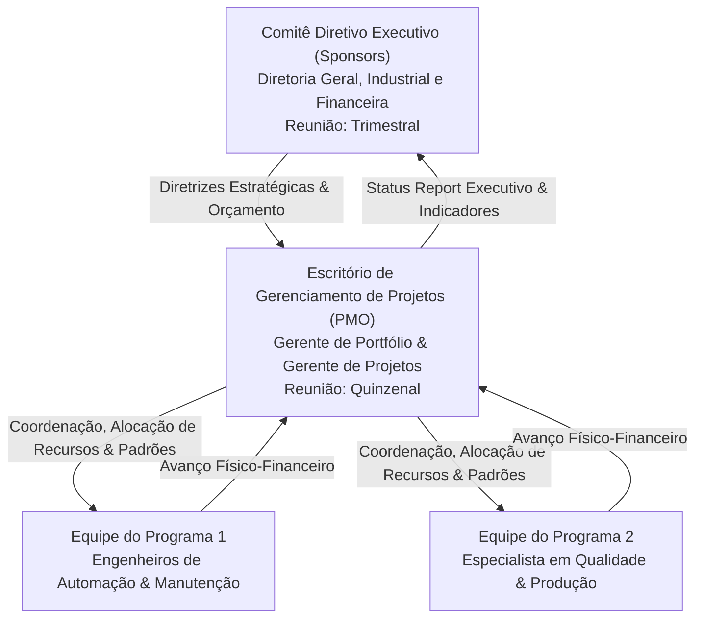

# 🔗 Etapa 2 — Estrutura de Programas e Governança do Portfólio

**Empresa:** MetalTech S.A.  
**Unidade:** Escritório de Gerenciamento de Projetos (PMO)  

---

## 1. Justificativa do Agrupamento em Programas

No gerenciamento estratégico segundo o PMBOK e os padrões do PMI:
> *"Um programa é um grupo de projetos relacionados, subprogramas e atividades de programa gerenciados de forma coordenada para obter benefícios e controle que não estariam disponíveis se fossem gerenciados individualmente."*

Na **MetalTech S.A.**, executar os projetos prioritários de forma fragmentada acarretaria conflitos severos de recursos humanos especializados e perda de sinergia entre produção, manutenção e garantia da qualidade. Portanto, os 5 projetos priorizados foram organizados em **dois programas estratégicos integrados**, com governança centralizada no PMO corporativo.

---

## 2. Estrutura Analítica do Portfólio

```text
PORTFÓLIO ESTRATÉGICO DA METALTECH S.A. (ANO 1)
│
├── 🏭 PROGRAMA 1: EXCELÊNCIA OPERACIONAL & MANUFATURA CONFIÁVEL
│   ├── P1: Automação da Linha 1 (Engenharia de Automação & Manufatura)
│   ├── P2: Sistema de Manutenção Preditiva (Manutenção Industrial & Confiabilidade)
│   └── P6: Treinamento e Capacitação de Operadores (Recursos Humanos & Operações)
│
├── 🎯 PROGRAMA 2: QUALIDADE INTEGRADA & DESPERDÍCIO ZERO
│   ├── P4: Programa de Redução de Refugo (Engenharia de Processos & Metalurgia)
│   └── P5: Modernização do Controle de Qualidade (Garantia da Qualidade & Metrologia)
│
└── 💼 INICIATIVAS E RESERVAS DO PMO
    ├── Reserva Estratégica de Contingência do Portfólio (R$ 400.000,00)
    └── Planejamento Conceitual da Fase 2 (Transição para P7 IoT e P3 ERP no Ano 2)
```

---

## 3. Detalhamento dos Programas Estratégicos

### 🏭 Programa 1: Excelência Operacional & Manufatura Confiável
* **Líder do Programa:** Gerente de Projetos (PMO) em conjunto com a Gerência Industrial.
* **Projetos Integrantes:**
  1. `P1` — Automação da Linha 1
  2. `P2` — Sistema de Manutenção Preditiva
  3. `P6` — Treinamento de Operadores
* **Objetivo Geral do Programa:**
  Modernizar a infraestrutura física e tecnológica da principal linha de usinagem e estampagem da MetalTech S.A., elevando a disponibilidade operacional das máquinas e dotando o corpo técnico e operacional de competências modernas de automação.
* **Benefícios Sinérgicos Esperados:**
  - **Atingimento da Meta de Produtividade (+15%):** A automação física de P1 (+12%) combinada com a redução de microparadas por erro de operação via P6 (+3%) atinge com precisão a meta estipulada pela diretoria.
  - **Atingimento da Meta de Disponibilidade (-20% de paradas):** A manutenção preditiva monitora em tempo real a vibração, óleo e temperatura dos motores e robôs instalados no P1, evitando quebras inesperadas que poderiam anular os ganhos de automação.
  - **Curva de Aprendizado Acelerada:** Os operadores começam os treinamentos em simuladores e células-piloto antes da entrega final de P1, eliminando a ociosidade da fábrica no "Go-Live".

---

### 🎯 Programa 2: Qualidade Integrada & Desperdício Zero (Zero Defect)
* **Líder do Programa:** Especialista em Qualidade em conjunto com a Engenharia de Produção.
* **Projetos Integrantes:**
  1. `P4` — Programa de Redução de Refugo
  2. `P5` — Modernização do Controle de Qualidade
* **Objetivo Geral do Programa:**
  Implantar um ciclo fechado de controle de qualidade na usinagem e conformação metálica, atacando tanto as causas geradoras de sobras e cavacos quanto as falhas de inspeção dimensional em componentes acabados.
* **Benefícios Sinérgicos Esperados:**
  - **Atingimento da Meta de Retrabalho (-30%):** O P5 moderniza instrumentos de medição tridimensional e sensores a laser, identificando desvios antes da montagem final.
  - **Atingimento da Meta de Redução de Custos (-10%):** A redução de 25% no refugo de matéria-prima (P4) gera economia direta e imediata de fluxo de caixa, além de reduzir o consumo energético por tonelada de peça produzida.
  - **Padronização e Certificação:** Unifica procedimentos operacionais padrão (POP) e simplifica o processo de auditoria de clientes automotivos exigentes (norma IATF 16949 / ISO 9001).

---

## 4. Governança e Papel do PMO

Para assegurar o cumprimento rigoroso do orçamento, prazos e metas, a MetalTech S.A. adotará um **modelo de governança corporativa em três níveis**:



### Atribuições do PMO:
1. **Monitoramento Integrado de Recursos:** Garantir que engenheiros de automação e analistas de TI não sofram sobrealocação entre os programas.
2. **Controle Financeiro de Linha de Base:** Monitorar mensalmente a curva de gastos frente aos R$ 2,1 milhões comprometidos e gerenciar a liberação criteriosa da reserva de R$ 400 mil.
3. **Gestão Integrada de Riscos:** Consolidar uma matriz unificada de riscos corporativos e articular ações de resposta com os líderes de projeto.
4. **Relatórios Executivos à Diretoria:** Produzir trimestralmente o *Dashboard de Valor Agregado* e evolução dos 4 KPIs estratégicos da empresa.
