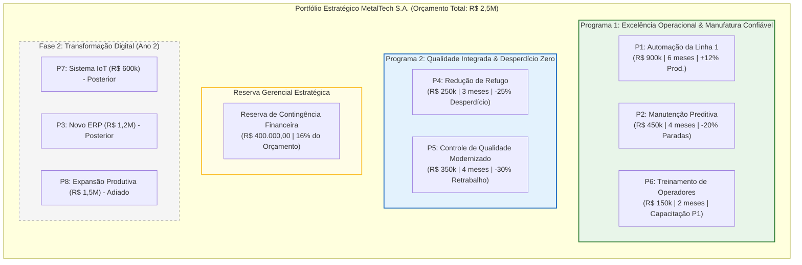

# 🏭 Desafio de Gestão de Portfólio e Programas — MetalTech S.A.

## 📌 Contexto Organizacional

A **MetalTech S.A.** é uma empresa fabricante de componentes metálicos de alta precisão para os setores automotivo e de máquinas industriais pesadas. Em resposta às novas demandas competitivas de mercado e à necessidade de modernização tecnológica, a diretoria executiva formulou um plano plurianual de inovação e estabeleceu **quatro objetivos estratégicos mandatórios** para os próximos 12 meses:

| Objetivo Estratégico | Meta Quantitativa | Indicador-Chave (KPI) |
|---|:---:|---|
| ⚙️ **Aumentar a Produtividade** | **+15%** | Peças produzidas por hora/homem |
| 🛠️ **Reduzir Paradas de Produção** | **-20%** | MTBF / Horas de paradas não planejadas |
| 📉 **Reduzir Custos Operacionais** | **-10%** | Custo unitário de manufatura e refugo |
| 🎯 **Melhorar a Qualidade** | **-30% de Retrabalho** | Taxa interna de defeitos e retrabalho |

---

## ⚠️ As Restrições Corporativas

O Escritório de Gerenciamento de Projetos (**PMO**) recebeu a missão de analisar 8 propostas de projetos estratégicos concorrentes, sob severas restrições operacionais e orçamentárias:

1. **Teto Orçamentário Máximo:** **R$ 2.500.000,00** (a soma dos projetos aprovados não pode ultrapassar este limite sob nenhuma hipótese).
2. **Equipe Técnica Especializada Restrita:**
   - 2 Engenheiros de Automação;
   - 2 Analistas de TI;
   - 1 Especialista em Qualidade;
   - 1 Gerente de Projetos;
   - 1 Especialista em Manutenção Industrial.
3. **Horizonte Temporal:** Plano de execução escalonado em exatamente **12 meses** (dividido em 4 trimestres: T1, T2, T3 e T4).
4. **Dependências Críticas e Interdependências:** Relações de pré-requisito e sinergia entre projetos de automação, capacitação, qualidade e sistemas.

---

## 🧭 Síntese da Decisão Estratégica do PMO

Após análise multicritério rigorosa de viabilidade, retorno sobre investimento (ROI), mitigação de riscos e alinhamento com as quatro metas da diretoria, a equipe do PMO determinou a seguinte configuração de portfólio:

* **Investimento Total em Execução:** **R$ 2.100.000,00** (84% do orçamento disponível).
* **Reserva de Contingência do Portfólio:** **R$ 400.000,00** (16% reservado para riscos imprevistos).
* **Atingimento das Metas:** **100% dos 4 objetivos estratégicos atendidos no Ano 1**.

---

## 📂 Documentos Deste Módulo

Para visualizar o detalhamento completo de cada etapa solicitada no desafio, acesse os arquivos a seguir:

1. [01 - Análise do Portfólio (Etapa 1)](01-analise-portfolio.md): Análise multicritério, dependências e classificação dos projetos P1 a P8.
2. [02 - Estruturação dos Programas e Governança (Etapa 2)](02-programas-e-governanca.md): Estrutura hierárquica, benefícios sinérgicos e papel do PMO.
3. [03 - Orçamento e Alocação de Recursos (Etapas 3 e 4)](03-orcamento-e-recursos.md): Distribuição orçamentária detalhada e nivelamento dos profissionais sem sobrecarga.
4. [04 - Roadmap de 12 Meses (Etapa 5)](04-roadmap-12-meses.md): Linha do tempo trimestral, gráfico de Gantt e marcos de entrega.
5. [05 - Slide Executivo para Diretoria (Entrega Final)](05-slide-executivo-diretoria.md): Slide visual consolidado em formato executivo e roteiro completo do pitch de 3 minutos.
