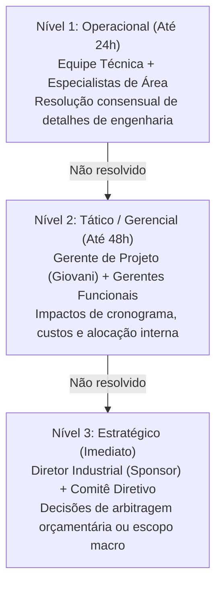

# 👥 Registro de Partes Interessadas e Plano de Comunicação

**Projeto:** Sistema Integrado de Automação e Gestão Industrial (SIGAI) — MetalTech S.A.  
**Área do Conhecimento:** Gerenciamento das Partes Interessadas e Comunicações (PMBOK)  
**Data:** Fevereiro de 2026 | **Versão:** 1.0  

---

## 1. Registro e Análise das Partes Interessadas (Stakeholders)

O sucesso da implantação do SIGAI depende da identificação proativa das expectativas, do grau de autoridade (poder) e do nível de interesse de cada agente impactado pelo projeto, prevenindo resistências culturais no chão de fábrica e mantendo o alinhamento com a diretoria.

### 📋 Matriz de Caracterização dos Stakeholders

| ID | Stakeholder / Grupo | Tipo | Papel no Projeto | Principais Expectativas e Interesses | Nível de Poder | Nível de Interesse | Classificação Estratégica |
|:---:|---|:---:|---|---|:---:|:---:|:---:|
| **STK-01** | Carlos Albuquerque (Diretor Industrial) | Interno | Patrocinador Executivo (Sponsor) | Retorno financeiro (ROI), cumprimento de prazos e metas corporativas de produtividade. | **Alto** | **Alto** | 🟢 **Gerenciar de Perto** |
| **STK-02** | Diretoria de TI / Governança | Interno | Validador de Infraestrutura & Segurança | Cibersegurança industrial, aderência aos padrões de banco de dados e estabilidade da rede. | **Alto** | **Médio** | 🟡 **Manter Satisfeito** |
| **STK-03** | Gerência de Produção & Supervisores | Interno | Usuários-Chave / Líderes Operacionais | Manter o ritmo de produção sem interrupções indesejadas; interface amigável e fácil. | **Médio** | **Alto** | 🟢 **Manter Informado / Engajar** |
| **STK-04** | Operadores da Linha 1 (Chão de Fábrica) | Interno | Usuários Finais Operacionais | Não ter aumento de carga de trabalho burocrática; estabilidade no emprego; treinamento adequado. | **Baixo** | **Alto** | 🔵 **Manter Informado / Capacitar** |
| **STK-05** | Equipe de Manutenção Industrial | Interno | Usuários Técnicos de Preditiva | Alertas confiáveis, diagnóstico antecipado de falhas e integração com Ordens de Serviço. | **Médio** | **Alto** | 🟢 **Gerenciar de Perto** |
| **STK-06** | Equipe de Garantia da Qualidade | Interno | Auditores de Conformidade | Confiabilidade metrológica dos sensores a laser e rastreabilidade total de componentes. | **Médio** | **Alto** | 🟢 **Gerenciar de Perto** |
| **STK-07** | Montadoras de Veículos (Clientes Finais) | Externo | Clientes Comerciais Estratégicos | Certificação IATF 16949, zero defeitos entregues e relatórios de rastreabilidade de lote. | **Alto** | **Médio** | 🟡 **Manter Satisfeito** |
| **STK-08** | Fornecedores de Sensores e Robótica | Externo | Fornecedores Técnicos Contratados | Prazos de pagamento em dia, especificações técnicas claras e liberação de acesso fabril. | **Baixo** | **Médio** | ⚪ **Monitorar** |

---

## 2. Matriz Poder × Interesse (Mapeamento Visual)

```mermaid
quadrantChart
    title Matriz de Stakeholders: Poder x Interesse
    x-axis Baixo Interesse --> Alto Interesse
    y-axis Baixo Poder --> Alto Poder
    quadrant-1 Gerenciar de Perto (Key Players)
    quadrant-2 Manter Satisfeito
    quadrant-3 Monitorar (Esforço Mínimo)
    quadrant-4 Manter Informado / Engajar
    "Carlos Albuquerque (Sponsor)": [0.85, 0.90]
    "Diretoria de TI": [0.45, 0.80]
    "Montadoras (Clientes)": [0.40, 0.75]
    "Gerência de Produção": [0.80, 0.60]
    "Garantia da Qualidade": [0.75, 0.55]
    "Manutenção Industrial": [0.70, 0.50]
    "Operadores de Máquina": [0.90, 0.25]
    "Fornecedores de Hardware": [0.35, 0.20]
```

### Estratégias de Engajamento Adotadas:
1. **Gerenciar de Perto (Diretor Industrial, Produção, Qualidade, Manutenção):** Reuniões quinzenais de acompanhamento, relatórios de valor agregado (EVM), validação formal de marcos e participação ativa nos testes em bancada.
2. **Manter Satisfeito (Diretoria de TI e Clientes Montadoras):** Relatórios mensais executivos de conformidade com padrões de segurança da informação e auditorias de qualidade.
3. **Manter Informado / Capacitar (Operadores da Linha 1):** Oficinas práticas prévias, diálogo diário de segurança (DDS), criação de programa de "Operador Destaque 4.0" para combater a resistência à mudança e demonstrar que o sistema reduz o trabalho repetitivo.
4. **Monitorar (Fornecedores):** Acompanhamento rigoroso de SLA de entrega e chamados técnicos de garantia via portal de compras.

---

## 3. Plano de Comunicação do Projeto (Estrutura 5W2H)

O plano garante que a informação correta chegue à pessoa certa, no momento oportuno, com o nível de detalhe adequado, evitando ruídos de comunicação.

| Evento de Comunicação | Informação Transmitida (What) | Objetivo da Comunicação (Why) | Público-Alvo (Who) | Canal / Mídia (Where) | Frequência (When) | Responsável (How) | Formato / Entregável |
|---|---|---|---|---|---|---|---|
| **Reunião de Kick-off** | Alinhamento do escopo, cronograma, papeis e regras do projeto. | Engajar a equipe e formalizar o início oficial dos trabalhos. | Todo o time do projeto, Sponsor e líderes de área. | Sala de Reunião Executiva / Teams presencial. | Única (no Mês 1). | Gerente de Projetos (Giovani Miamoto) | Apresentação em Slides e Ata Formal de Reunião. |
| **Status Report Executivo** | Avanço físico-financeiro, marcos atingidos, desvios e decisões pendentes. | Prestar contas à diretoria e obter aprovação para ajustes orçamentários. | Sponsor (Carlos A.) e Comitê Executivo. | E-mail executivo com link para Dashboard BI. | Mensal (última sexta-feira). | Gerente de Projetos | Relatório Sintético em PDF (1 página) + Dashboard Power BI. |
| **Daily Standup Operacional** | "O que fiz ontem, o que farei hoje, quais impedimentos existem". | Identificar gargalos técnicos rápidos e destravar a equipe no dia a dia. | Equipe técnica de automação, TI e manutenção. | Presencial no Laboratório / Quarto de Guerra do Projeto. | Diária (15 minutos pela manhã). | Scrum Master / Líder Técnico | Quadro Kanban físico/digital no Jira. |
| **Alinhamento de Integração** | Validação de diagramas de CLP, protocolos de rede e testes funcionais. | Assegurar que hardware e software dialoguem sem inconsistências. | Engenharia de Automação e Analistas de TI. | Híbrido (Sala técnica + bancada de testes). | Semanal (toda terça-feira). | Líder Técnico de Automação | Registro técnico de integrações e ata de decisões. |
| **Boletim "Fábrica Digital"** | Notícias das melhorias na linha, fotos das novas bancadas e depoimentos. | Desmistificar a tecnologia, valorizar os operadores e engajar o chão de fábrica. | Operadores, supervisores e líderes de turno da fábrica. | Murais digitais da fábrica e TV interna do refeitório. | Quinzenal. | RH / Comunicação Interna (apoiado pelo GP) | Card visual impresso e vídeo curto de 1 minuto. |
| **Comitê de Controle de Mudanças (CCB)** | Análise formal de solicitações de alteração de escopo, prazo ou custo. | Evitar aumento descontrolado de escopo (scope creep) e preservar baseline. | GP, Sponsor, Gerente de Qualidade e Líder de TI. | Reunião extraordinária presencial/Teams. | Sob demanda (sempre que houver Change Request). | Gerente de Projetos | Formulário de Change Request assinado e parecer técnico. |

---

## 4. Matriz de Escalação e Resolução de Conflitos

Em situações de divergência técnica ou operacional que ameacem o andamento do projeto, adota-se o seguinte fluxo de resolução em até 48 horas:


