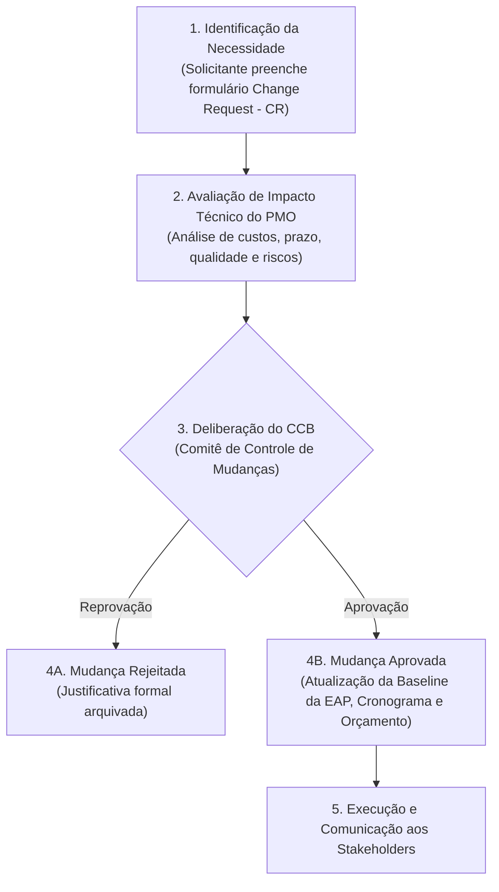

# 📦 Gerenciamento do Escopo e Estrutura Analítica do Projeto (EAP)

**Projeto:** Sistema Integrado de Automação e Gestão Industrial (SIGAI) — MetalTech S.A.  
**Área do Conhecimento:** Gerenciamento do Escopo (PMBOK / UniSENAI-SP)  
**Versão:** 1.0 | **Data de Elaboração:** Fevereiro de 2026  

---

## 1. Declaração do Escopo do Projeto

### 1.1 Descrição do Escopo do Produto
O produto final consiste no **Sistema Integrado de Automação e Gestão Industrial (SIGAI)**, composto por uma camada física de instrumentação fabril (painéis elétricos inteligentes, sensores de vibração/temperatura em 16 máquinas, leitores industriais DataMatrix e redes industriais PROFINET/Modbus TCP) e uma camada de software (middleware de comunicação OPC UA, módulo de coleta de dados de chão de fábrica, portal supervisório web responsivo para cálculo automático de OEE e integração direta com o banco de dados corporativo da MetalTech S.A.).

### 1.2 Descrição do Escopo do Projeto
O escopo do projeto engloba todas as etapas de gestão e engenharia necessárias para conceber, adquirir, instalar, programar, testar, validar, capacitar e comissionar o sistema, incluindo:
- Levantamento e documentação da arquitetura técnica de engenharia.
- Adequação física de cabeamento de fibra óptica e alimentação estabilizada na Linha 1 de Usinagem.
- Aquisição e instalação de 32 conjuntos de sensores industriais e 4 gateways IoT.
- Desenvolvimento customizado das telas de IHM para operadores e dashboards executivos.
- Homologação em ambiente de testes e comissionamento com carga na planta industrial.
- Treinamento presencial de 48 colaboradores operacionais e de manutenção.
- Operação assistida pelo período de 60 dias corridos.

### 1.3 Exclusões Explícitas do Escopo (Não-Escopo)
Para blindar o projeto contra acréscimos indevidos (*scope creep*), foram estabelecidas as seguintes exclusões formais:
- ❌ Não inclui automação ou conexão de máquinas das Linhas 2, 3 e 4 da MetalTech S.A.
- ❌ Não inclui compra, reforma mecânica pesada ou substituição de centros de usinagem ou prensas existentes.
- ❌ Não inclui desenvolvimento ou modificação do módulo de folha de pagamento ou contabilidade geral da empresa.
- ❌ Não inclui obras civis pesadas de ampliação do galpão industrial.

---

## 2. Estrutura Analítica do Projeto (EAP / WBS)

A EAP foi decomposta orientada estritamente a **entregas e produtos verificáveis**, em conformidade com as diretrizes do template oficial do curso (`Modelo - 5.1`).

```text
PROJETO SIGAI — METALTECH S.A.
│
├── 1. GERENCIAMENTO DO PROJETO
│   ├── 1.1 Termo de Abertura e Plano Integrado Aprovados
│   ├── 1.2 Reuniões de Governança e Relatórios de Status Executivos
│   └── 1.3 Encerramento Contratual e Termo de Lições Aprendidas
│
├── 2. ENGENHARIA E ESPECIFICAÇÃO TÉCNICA
│   ├── 2.1 Especificação de Requisitos de Automação e TI Concluída
│   ├── 2.2 Projeto Executivo de Painéis Elétricos e Redes Aprovado
│   └── 2.3 Edital Técnico e Contratos de Fornecedores Firmados
│
├── 3. INFRAESTRUTURA FÍSICA E INSTRUMENTAÇÃO
│   ├── 3.1 Cabeamento Estruturado e Rede Fibra Óptica Instalados
│   ├── 3.2 Painéis Elétricos e Racks Industriais Montados
│   └── 3.3 Sensores Preditivos e Leitores DataMatrix Fixados nas Máquinas
│
├── 4. DESENVOLVIMENTO E INTEGRAÇÃO DE SOFTWARE
│   ├── 4.1 Servidores e Banco de Dados Fabril Configurados
│   ├── 4.2 Camada de Comunicação OPC UA e Drivers de CLP Parametrizados
│   ├── 4.3 Interface Homem-Máquina (IHM) para Chão de Fábrica Desenvolvida
│   └── 4.4 Dashboard Gerencial de OEE e Rastreabilidade Homologado
│
├── 5. TESTES, VALIDAÇÃO E COMISSIONAMENTO
│   ├── 5.1 Testes de Bancada e Simulação Lógica Realizados
│   ├── 5.2 Teste Integrado com Carga na Linha 1 Executado
│   └── 5.3 Auditoria de Acurácia Metrológica e Confiabilidade Validada
│
└── 6. TRANSIÇÃO, CAPACITAÇÃO E OPERAÇÃO ASSISTIDA
    ├── 6.1 Manuais Operacionais e Procedimentos Padrão (POP) Homologados
    ├── 6.2 Programa de Capacitação de Operadores e Manutenção Concluído
    ├── 6.3 Operação Assistida de 60 Dias Executada
    └── 6.4 Termo de Aceite Definitivo do Sistema Assinado
```

---

## 3. Dicionário da EAP (WBS Dictionary)

| Código EAP | Elemento / Pacote de Trabalho | Descrição do Conteúdo e Trabalho Envolvido | Entregável Associado | Critério de Aceitação Mensurável |
|:---:|---|---|---|---|
| **1.1** | Termo de Abertura e Plano Integrado | Elaboração e aprovação do TAP, escopo, cronograma, custos, riscos e matriz RACI. | Plano de Gerenciamento do Projeto consolidado. | Assinatura formal do Sponsor e Comitê Diretivo. |
| **1.2** | Reuniões e Relatórios de Status | Condução de reuniões de acompanhamento, relatórios quinzenais de EVM e reuniões de CCB. | Atas de reunião e relatórios mensais de avanço. | 100% dos relatórios entregues no último dia útil do mês. |
| **1.3** | Encerramento e Lições Aprendidas | Desmobilização de recursos, auditoria financeira e consolidação das lições aprendidas. | Relatório de Encerramento do Projeto. | Quitação financeira e ata de post-mortem aprovada. |
| **2.1** | Requisitos de Automação e TI | Mapeamento dos sinais analógicos/digitais de 16 máquinas e interfaces necessárias. | Documento de Especificação de Requisitos (SRS). | Validação técnica da Manutenção e TI sem pendências. |
| **2.2** | Projeto Executivo Elétrico e Redes | Desenho elétrico unifilar, diagrama de topologia de rede PROFINET e lista de materiais. | Plantas elétricas e diagramas em CAD aprovados. | Conformidade com normas técnicas NR-10 e NR-12. |
| **2.3** | Contratos de Fornecedores | Cotação, negociação, homologação de fornecedores e formalização de pedidos de compra. | Ordens de compra emitidas e contratos assinados. | Itens contratados dentro da baseline orçamentária. |
| **3.1** | Rede Fibra Óptica e Conectividade | Lançamento de eletrocalhas, fusão de fibra óptica e certificação de rede gigabit. | Anel de fibra óptica industrial certificado. | Teste de perda óptica < 0,5 dB/km e certificação Fluke. |
| **3.2** | Painéis Elétricos Montados | Montagem mecânica e fiação de 4 painéis de comando com nobreaks e switches gerenciáveis. | Painéis de automação energizados na fábrica. | Testes de isolamento elétrico e ART recolhida. |
| **3.3** | Sensores e Leitores Instalados | Fixação mecânica e ligação de acelerômetros de vibração, PT-100 e câmeras DataMatrix. | 32 sensores e 16 leitores operantes no maquinário. | Todos os sensores transmitindo sinal elétrico estável. |
| **4.1** | Servidores e Banco de Dados | Provisionamento de máquina virtual Linux/Docker e instalação de banco de dados PostgreSQL. | Servidor industrial ativo na DMZ de manufatura. | Latência de rede < 5ms e backup automático configurado. |
| **4.2** | OPC UA e Drivers de CLP | Configuração de drivers de leitura dos CLPs Siemens e Rockwell para coleta contínua de dados. | Conexão de telemetria estabelecida em tempo real. | Taxa de amostragem de dados de 1 segundo sem perda de pacotes. |
| **4.3** | IHM de Chão de Fábrica | Desenvolvimento de telas touch-screen para os postos de trabalho para apontamento de motivos de parada. | Telas de IHM instaladas nos terminais da Linha 1. | Tempo de registro de parada pelo operador < 15 segundos. |
| **4.4** | Dashboard OEE e Rastreabilidade | Criação de dashboards de disponibilidade, performance, qualidade e histórico de peças. | Aplicação web com acesso multiusuário liberado. | Acurácia do cálculo de OEE em 99,5% confrontada com dados reais. |
| **5.1** | Testes de Bancada e Simulação | Validação lógica de algoritmos e alarmes em ambiente controlado de laboratório antes da fábrica. | Relatório de testes FAT (Factory Acceptance Test). | 100% dos casos de teste críticos aprovados sem bugs severos. |
| **5.2** | Teste Integrado com Carga | Rodagem do sistema durante um turno de produção regular para aferir telemetria e estresse. | Relatório de testes SAT (Site Acceptance Test). | Operação ininterrupta por 8 horas sem falhas de software. |
| **5.3** | Auditoria Metrológica | Confrontação das medições a laser dos sensores de qualidade com peças padrão aferidas. | Laudo metrológico emitido pela Garantia da Qualidade. | Margem de erro do sensor de qualidade inferior a 0,02 mm. |
| **6.1** | Manuais e POPs | Elaboração de apostilas didáticas, vídeos instrucionais e guias de resolução de problemas. | Procedimentos Operacionais Padrão publicados. | Documentos aprovados pela Gestão da Qualidade da MetalTech. |
| **6.2** | Capacitação das Equipes | Realização de treinamentos teóricos e práticos para 4 turmas de operadores e manutenção. | Listas de presença e certificados emitidos. | Mínimo de 85% de aproveitamento na avaliação prática. |
| **6.3** | Operação Assistida | Plantão diário de analistas e engenheiros durante a produção para ajustes finos imediatos. | Relatórios semanais de estabilidade operacional. | MTTR de chamados de suporte técnico inferior a 30 minutos. |
| **6.4** | Termo de Aceite Definitivo | Avaliação final do Sponsor e emissão do aceite formal de encerramento do projeto. | Termo de Aceite Definitivo assinado. | Atingimento das metas SMART estipuladas no TAP. |

---

## 4. Processo Formal de Gestão e Controle de Mudanças no Escopo

Para impedir desvios de escopo que comprometam o custo e o prazo final de novembro de 2026, nenhum acréscimo funcional será implementado sem seguir o fluxo rigoroso de controle:



### Regras do Comitê de Mudanças:
1. **Impacto Neutro ou Baixo (< R$ 10.000 e sem impacto no caminho crítico):** Avaliado e aprovado conjuntamente pelo Gerente de Projeto e Líder Técnico.
2. **Impacto Significativo (> R$ 10.000 ou impacto > 5 dias no caminho crítico):** Exige deliberação unânime do Sponsor (Diretor Industrial) e recálculo da reserva de contingência.
