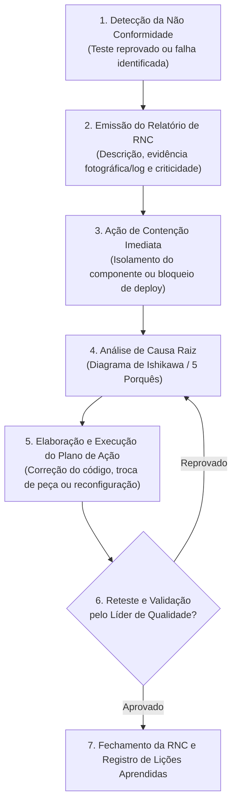

# 🎯 Gerenciamento da Qualidade e Critérios de Aceitação

**Projeto:** Sistema Integrado de Automação e Gestão Industrial (SIGAI) — MetalTech S.A.  
**Área do Conhecimento:** Gerenciamento da Qualidade (PMBOK / UniSENAI-SP)  
**Versão:** 1.0 | **Data de Elaboração:** Fevereiro de 2026  

---

## 1. Padrões Normativos e Requisitos de Qualidade

Para garantir a confiabilidade operacional e a aceitação das peças pelos clientes do setor automotivo, o projeto SIGAI é regido pelas seguintes normas técnicas:

1. **ISO 9001:2015:** Sistema de Gestão da Qualidade — Foco na padronização dos processos, rastreabilidade e melhoria contínua.
2. **IATF 16949:2016:** Padrão Global da Indústria Automotiva — Exigência mandatória de rastreabilidade unitária de componentes críticos e prevenção de falhas (FMEA).
3. **ISO/IEC 25010:2011:** Engenharia de Software — Modelo de Qualidade de Produto de Software, avaliando adequação funcional, eficiência de desempenho, usabilidade, confiabilidade e segurança.
4. **Normas Regulamentadoras Brasileiras:**
   - **NR-10:** Segurança em instalações e serviços em eletricidade (painéis industriais).
   - **NR-12:** Segurança no trabalho em máquinas e equipamentos (travamentos e intertravamentos de segurança).

---

## 2. Matriz de Métricas e Padrões de Qualidade

| Dimensão da Qualidade | Indicador / Métrica | Valor Alvo (Meta) | Método de Medição / Instrumento | Frequência de Avaliação |
|---|---|:---:|---|---|
| **Acurácia Metrológica** | Desvio dimensional nas leituras dos sensores ópticos | $\le 0,02 \text{ mm}$ | Confrontação com bloco-padrão calibrado RBC | Semanal durante SAT e operação |
| **Tempo de Coleta de Dados** | Latência de transmissão CLP $\rightarrow$ Banco de Dados | $\le 1,0 \text{ segundo}$ | Log de telemetria do servidor OPC UA | Amostragem contínua |
| **Disponibilidade do Software** | *Uptime* do servidor de chão de fábrica | $\ge 99,8\%$ | Monitoramento automático Zabbix/Prometheus | Mensal |
| **Integridade de Rastreamento** | Taxa de leitura bem-sucedida de códigos DataMatrix | $\ge 99,9\%$ | Leitores ópticos industriais nas células | Por lote de produção |
| **Usabilidade da IHM** | Tempo médio do operador para apontar motivo de parada | $\le 15 \text{ segundos}$ | Teste cronometrado com 10 operadores | Fim do treinamento |
| **Densidade de Bugs** | Defeitos críticos ou impeditivos no software | **0 bugs** | Testes de regressão e homologação FAT | Em cada release de software |

---

## 3. Atividades de Garantia (QA) e Controle da Qualidade (QC)

### 3.1 Garantia da Qualidade (Quality Assurance — QA)
Processos orientados à prevenção de defeitos na concepção e execução do projeto:
- **Revisão Técnica por Pares (Peer Review):** Todo projeto elétrico e diagrama de banco de dados deve ser revisado por ao menos dois especialistas antes da compra de materiais.
- **Auditoria de Conformidade Normativa:** Verificação da conformidade das instalações elétricas e cabeamento óptico segundo a ABNT NBR 5410 e normas industriais.
- **Ambiente de Teste Padronizado:** Manutenção de um ambiente de *homologação* idêntico ao de produção para validação prévia de releases de software.

### 3.2 Controle da Qualidade (Quality Control — QC)
Inspeções e testes pontuais para verificar conformidade dos entregáveis:
1. **FAT (Factory Acceptance Test — Teste de Aceitação em Fábrica):**
   - Realizado em bancada de laboratório antes da montagem na fábrica.
   - Simulação de falhas de comunicação, sobrecarga de dados e respostas de segurança.
2. **SAT (Site Acceptance Test — Teste de Aceitação em Campo):**
   - Realizado na Linha 1 em condições reais de usinagem e estampagem mecânica.
   - Teste de estresse com 16 máquinas enviando dados simultaneamente por 8 horas.
3. **Auditoria Metrológica de Conformidade:**
   - Laudo técnico emitido pelo laboratório de metrologia da MetalTech atestando que os sensores a laser detectam desvios dimensionais com exatidão.

---

## 4. Fluxo de Tratamento de Não Conformidades (RNC)

Quando uma entrega ou componente falha nos testes ou desvia dos critérios normativos, aciona-se o fluxo formal de não conformidade:

---

## 5. Checklist de Verificação e Aceite de Entregas Principais

| Pacote EAP | Item Verificado | Critério Mínimo para Aceite | Status | Avaliador Responsável |
|:---:|---|---|:---:|---|
| **3.1** | Fusão e certificação da fibra óptica | Atenuação $< 0,5 \text{ dB/km}$ e laudo Fluke sem falhas | [ ] | Analista de TI / Fornecedor |
| **3.2** | Painéis elétricos industriais | Aterramento $< 5 \ \Omega$, proteção IP66 e ART recolhida | [ ] | Eng. Automação / NR-10 |
| **3.3** | Sensores de vibração/temperatura | 32 sensores montados e calibrados contra padrões | [ ] | Manutenção / Qualidade |
| **4.2** | Conexão OPC UA | 100% dos CLPs lidos com latência $\le 1$ segundo | [ ] | Analista de TI |
| **4.4** | Dashboard de OEE | Cálculo validado manualmente com divergência $< 0,5\%$ | [ ] | Gerência de Produção |
| **6.2** | Treinamento dos operadores | Mínimo de 85% de nota na prova prática e presença $\ge 90\%$ | [ ] | Recursos Humanos / Instrutor |
| **6.4** | Termo de Aceite Definitivo | Todas as RNCs críticas encerradas e 4 metas atingidas | [ ] | Sponsor (Carlos A.) / GP |
