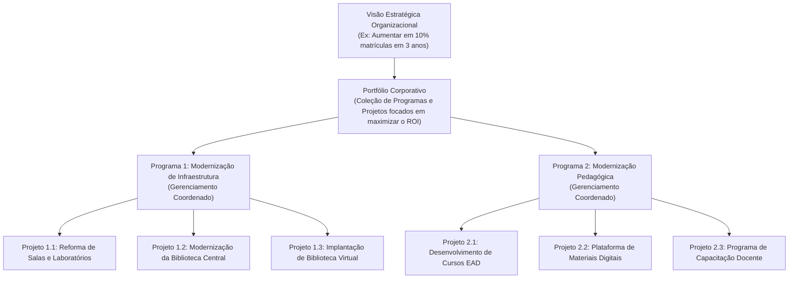

# Resumo Acadêmico da Aula 01: Apresentação da Disciplina e Contextualização

- **Curso:** Tecnologia em Análise e Desenvolvimento de Sistemas (ADS)
- **Disciplina:** Gestão de Projetos de TI
- **Instituição:** Faculdade de Tecnologia SENAI Antoine Skaf (UniSENAI-SP)
- **Docente:** Prof. Me. Deivison S. Takatu (`deivison.takatu@edu.senai.br`)
- **Discente Responsável:** Giovani Miamoto (`giovanimiamotob`)

---

## 1. Visão Geral e Metodologia de Ensino (PBL)

A disciplina de Gestão de Projetos fundamenta-se na **Aprendizagem Baseada em Projetos (PBL - *Project-Based Learning*)**, uma abordagem pedagógica ativa centrada no estudante. Por meio do PBL, os acadêmicos desenvolvem competências práticas solucionando problemas reais, complexos e mal estruturados, simulando o ecossistema corporativo de engenharia de software e gestão de tecnologia.

O trabalho em equipe multidisciplinar espelha a dinâmica de empresas de tecnologia, preparando o futuro profissional para liderar iniciativas, orquestrar entregas contínuas e integrar soluções de software a requisitos estratégicos corporativos.

---

## 2. O Conceito de Projeto vs. Operações Contínuas

De acordo com o **PMI (*Project Management Institute*)**, um **projeto** é definido formalmente como:

> *"Um esforço temporário empreendido para criar um produto, serviço ou resultado exclusivo."* (PMBOK® Guide)

### Características Fundamentais de um Projeto:
1. **Temporalidade:** Possui início e fim claramente definidos. Não é um ciclo perpétuo.
2. **Exclusividade (Singularidade):** O produto, serviço ou resultado gerado difere de maneira substantiva de outras entregas prévias da organização.
3. **Elaboração Progressiva:** Desenvolve-se em etapas sucessivas; o detalhamento técnico e gerencial aumenta à medida que o projeto avança e as incertezas diminuem.

### Quadro Comparativo: Projetos versus Operações

| Dimensão | Projetos (Project Management) | Operações (Business Operations) |
| :--- | :--- | :--- |
| **Objetivo** | Produzir uma mudança, inovar, criar algo novo | Manter a organização funcionando de forma estável |
| **Duração** | Temporária (início e término delimitados) | Contínua e permanente |
| **Resultado** | Exclusivo, único (ex: novo software FieldOps) | Repetitivo, padronizado (ex: atendimento N1 de suporte) |
| **Equipe** | Multidisciplinar, temporária, desmobilizável | Funcional, departamentalizada e permanente |
| **Gestão de Risco** | Elevada incerteza inerente à inovação | Foco em previsibilidade, qualidade e Six Sigma |

---

## 3. Por que Estudar Gestão de Projetos na Área de TI?

No mercado contemporâneo de software, o sucesso não depende exclusivamente de habilidades de codificação, mas da capacidade de entregar valor sob restrições severas de prazo, escopo, custo e qualidade. A gestão estruturada propicia:
- **Redução drástica de desperdício:** Eliminação de retrabalho em arquitetura e requisitos.
- **Previsibilidade e controle:** Acompanhamento rigoroso de prazos e curvas de investimento.
- **Elevação da qualidade:** Testes automatizados, critérios de aceite claros (*Definition of Done*) e governança técnica.
- **Alinhamento estratégico:** Garantia de que cada linha de código contribua diretamente para os objetivos da empresa.

---

## 4. O Papel e Habilidades do Gerente de Projetos

O Gerente de Projetos moderno transcende o papel de mero distribuidor de tarefas; ele atua como líder servidor e facilitador de negócios, integrando competências sintetizadas no Triângulo de Talentos do PMI:

```
               [ Liderança e Gestão de Pessoas ]
                             /   \
                            /     \
                           /       \
     [ Gestão Técnica de Projetos ] --- [ Gestão Estratégica e de Negócios ]
```

### Competências Críticas Abordadas em Aula:
- **Liderança e Construção de Equipes:** Alinhar objetivos, delegar com clareza e manter o time motivado.
- **Comunicação Assertiva e Influência:** Garantir fluidez de informações entre desenvolvedores e diretoria executiva (*C-Level*).
- **Tomada de Decisão e Gestão de Conflitos:** Mediar atritos técnicos, balancear débitos técnicos e gerenciar *trade-offs*.
- **Negociação e Consciência Cultural:** Alinhar expectativas de escopo com clientes e patrocinadores (*sponsors*).
- **Mentoria e Coaching:** Desenvolver maturidade técnica e comportamental dos membros da equipe.

---

## 5. Ciclo de Vida do Projeto e Fases PMBOK

O ciclo de vida engloba cinco grupos de processos universais que interagem de forma iterativa ao longo do tempo:


1. **Iniciação:** Reconhecimento formal da necessidade; autorização do projeto via Termo de Abertura do Projeto (TAP) e mapeamento inicial de *stakeholders*.
2. **Planejamento:** Definição completa do escopo (EAP), cronograma (redes de dependência e caminho crítico), orçamento, plano de qualidade, matriz de riscos e aquisições.
3. **Execução:** Alocação de pessoas, orquestração técnica dos entregáveis e integração de software.
4. **Monitoramento e Controle:** Medição de desempenho físico-financeiro (EVM), controle integrado de mudanças e auditorias de qualidade.
5. **Encerramento:** Homologação formal das entregas, transição operacional para o cliente/sustentação e registro das Lições Aprendidas.

---

## 6. As 10 Áreas de Conhecimento do PMBOK (47 Processos)

O guia PMBOK organiza a gestão nas seguintes dimensões integradas:
1. **Gerenciamento da Integração:** Coesão de todos os planos, TAP, monitoramento e encerramento.
2. **Gerenciamento do Escopo:** Coleta de requisitos, declaração de escopo, elaboração da EAP e controle de desvios (*scope creep*).
3. **Gerenciamento do Tempo / Cronograma:** Decomposição de atividades, sequenciamento, estimativas de duração e caminho crítico (CPM).
4. **Gerenciamento de Custos:** Orçamentação analítica (CAPEX/OPEX), fluxo de caixa e Análise do Valor Agregado (EVA/EVM).
5. **Gerenciamento da Qualidade:** Planejamento de métricas, garantia de qualidade e aplicação das ferramentas estatísticas de controle.
6. **Gerenciamento de Recursos Humanos:** Alocação de papéis, Matriz de Responsabilidades (RACI) e desenvolvimento do time.
7. **Gerenciamento das Comunicações:** Mapeamento de canais, matriz 5W2H de comunicação e relatórios de progresso (*status reports*).
8. **Gerenciamento de Riscos:** Identificação (EAR), análise qualitativa/quantitativa (Matriz 5x5), respostas a ameaças e oportunidades.
9. **Gerenciamento das Aquisições:** Seleção de fornecedores, contratos (*fixed price*, *time and materials*) e logística de insumos.
10. **Gerenciamento das Partes Interessadas (*Stakeholders*):** Identificação de influência/interesse e estratégias de engajamento contínuo.

---

## 7. Estratégia Organizacional: Portfólio, Programas e Projetos

A aula demonstrou como a estratégia corporativa se desdobra hierarquicamente para atingir resultados palpáveis:



- **Portfólio:** Agrupamento de projetos, programas e operações gerenciados em conjunto para atingir os objetivos estratégicos da organização (foco em seleção e priorização).
- **Programa:** Grupo de projetos correlacionados e interdependentes gerenciados de maneira coordenada para auferir benefícios que não seriam obtidos se fossem geridos individualmente.
- **Projeto:** Esforço pontual que materializa uma entrega específica dentro de um programa ou portfólio.

---

## 8. Abordagens Preditivas (Cascata) vs. Ágeis (Scrum/Kanban)

A gestão contemporânea em TI adota majoritariamente o modelo **Híbrido**:
- **Governança Preditiva (PMBOK):** Utilizada no nível executivo para planejamento financeiro, contratos com clientes externos, marcos contratuais (*milestones*) e gestão global de riscos corporativos.
- **Operação Ágil (Scrum / Kanban):** Utilizada no nível técnico pelo time de desenvolvimento (Sprints de 2 semanas, Daily Meetings, refinamento contínuo de Backlog, entregas frequentes em ambiente de Staging).

---

## 9. Sistema de Avaliação da Disciplina e Estrutura dos Entregáveis

Conforme estipulado no Plano de Ensino da disciplina, a avaliação compõe-se de:
1. **55% — Avaliação Docente:**
   - 20% Desenvolvimento do Projeto (Documentação técnica completa estilo "Mini-TCC");
   - 20% Apresentação Executiva do Projeto (Banca, benchmarking e demonstração prática);
   - 15% Realização das atividades semanais práticas de cada aula.
2. **35% — Projeto Integrador (PI):**
   - Entregáveis interdisciplinares avaliados colegiadamente no semestre.
3. **10% — Autoavaliação discente.**

---

## 10. Referências Bibliográficas da Aula

1. CARVALHO, Fábio Câmara Araújo de. **Gestão de projetos**. 2. ed. São Paulo: Pearson, 2018.
2. SOUZA, Carla Patricia da Silva. **Gestão de projetos**. 1. ed. São Paulo: Contentus, 2020.
3. BUENO, Gislaine. **Gestão de projetos para cibersecurity**. 1. ed. São Paulo: Contentus, 2020.
4. BUNGART, José Wagner; POSSARLE, Roberto. **Metodologia de projetos: conceitos, planejamento e desenvolvimento**. São Paulo: SENAI-SP Editora, 2017.
5. CRUZ, Fábio. **Scrum e PMBOK unidos no gerenciamento de projetos**. Rio de Janeiro: Brasport, 2013.
6. PROJECT MANAGEMENT INSTITUTE (PMI). **A Guide to the Project Management Body of Knowledge (PMBOK® Guide)**. 6. ed. Pensilvânia: PMI, 2017.
