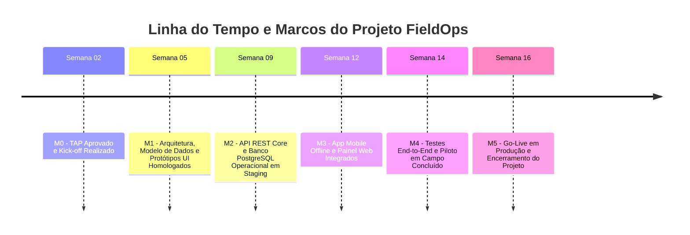

# Termo de Abertura do Projeto (TAP) — Projeto FieldOps
## Plataforma Integrada de Inspeção Técnica em Campo

- **Disciplina:** Gestão de Projetos de TI (UniSENAI-SP)
- **Docente:** Prof. Me. Deivison S. Takatu
- **Autor / Gerente de Projetos:** Giovani Miamoto (`giovanimiamotob`)
- **Projeto Integrador do Semestre:** SIGAI (MetalTech S.A.) — *TAP completo disponível em [01-termo-de-abertura-tap.md](../02-projeto-integrador/avaliacao-1-planejamento-inicial/01-termo-de-abertura-tap.md)*
- **Data de Emissão:** 20/11/2026
- **Versão:** 1.0 (Aprovada)

---

## 1. Identificação do Projeto e Contextualização

| Campo | Descrição |
| :--- | :--- |
| **Título do Projeto** | FieldOps — Plataforma de Inspeção Técnica em Campo |
| **Código do Projeto** | PRJ-FOPS-2026-01 |
| **Patrocinador Executivo (*Sponsor*)** | Diretoria de Operações e Serviços Industriais |
| **Gerente do Projeto (PM)** | Giovani Miamoto (Líder Técnico & Gestão de Projetos) |
| **Cliente / Usuários Principais** | Supervisores Técnicos, Técnicos de Campo e Clientes Contratantes |
| **Classificação Estratégica** | Transformação Digital, Eficiência Operacional e Padronização de Qualidade |

---

## 2. Justificativa do Projeto (Business Case)

Atualmente, as rotinas de inspeção técnica preventiva e corretiva em ativos operacionais, prediais e industriais dependem majoritariamente de **processos manuais e analógicos**: formulários em papel (fichas de inspeção impressas), planilhas avulsas de controle, mensagens em aplicativos informais (WhatsApp) e fotografias desorganizadas armazenadas na galeria pessoal de aparelhos dos técnicos.

Esse modelo operacional acarreta severos gargalos:
1. **Extravio e Ilegibilidade de Dados:** Perda frequente de formulários físicos e erros na digitação manual para os sistemas internos.
2. **Morosidade no Faturamento e SLA:** O tempo médio decorrido entre a conclusão da inspeção em campo e a emissão do laudo técnico com aprovação do supervisor ultrapassa **72 horas úteis**.
3. **Falta de Rastreabilidade e Auditoria:** Ausência de comprovação georreferenciada (coordenadas GPS) e validação da identidade dos equipamentos vistoriados.
4. **Vulnerabilidade em Zonas Remotas:** Técnicos atuam com frequência em subsolos, galpões industriais blindados e áreas rurais desprovidas de cobertura 4G/5G, impedindo o preenchimento de ferramentas baseadas exclusivamente em navegadores web.

A plataforma **FieldOps** surge como resposta estratégica, digitalizando ponta a ponta o ciclo de vida das inspeções com suporte nativo à operação *offline-first*.

---

## 3. Objetivos do Projeto (Metas SMART)

1. **Digitalização Integral (Específico):** Desenvolver e implantar uma solução integrada composta por Aplicativo Mobile Android (*offline-first*), Painel Administrativo Web e API REST centralizadora.
2. **Redução de Tempo de Ciclo (Mensurável):** Reduzir o tempo médio de disponibilização do laudo técnico para revisão de 72 horas para **menos de 4 horas** após a conclusão do checklist pelo técnico.
3. **Produtividade em Campo (Atingível):** Elevar a capacidade de atendimento técnico em **25%** nos primeiros 6 meses de implantação, eliminando o preenchimento de pranchetas de papel.
4. **Confiabilidade de Evidências (Relevante):** Assegurar 100% de conformidade com registros fotográficos obrigatórios e identificação unívoca por QR Code do equipamento.
5. **Prazo de Entrega do MVP (Temporal):** Concluir o desenvolvimento, testes e homologação do MVP em **16 semanas** (4 meses), respeitando o orçamento inicial aprovado.

---

## 4. Escopo do Produto e Limites do Projeto

### 4.1. No Escopo do MVP (Inclusões Obrigatórias)
- **Interface Administrativa Web (Supervisores / Gestores):**
  - Autenticação com controle de acesso baseado em papéis (RBAC - Admin vs. Supervisor).
  - Cadastro de clientes, plantas industriais/locais e inventário de equipamentos com geração de QR Code.
  - Construtor dinâmico de modelos de checklist (itens tipo texto, numérico, múltipla escolha, fotos obrigatórias).
  - Agendamento de inspeções e atribuição inteligente a técnicos designados.
  - Painel de monitoramento do status das ordens de inspeção (Pendente, Em Andamento, Sincronizada, Sob Revisão, Aprovada, Reprovada).
  - Módulo de revisão de laudos com visualização de fotografias, comparativo de conformidade e fluxo de devolução com apontamentos para correção.
- **Aplicativo Mobile (Técnicos de Campo - Android prioritário):**
  - Autenticação e sincronização prévia de ordens de serviço atribuídas.
  - Operação 100% *offline-first* suportada por banco de dados local SQLite.
  - Leitura de QR Code para validação presencial do equipamento antes do início do checklist.
  - Preenchimento do checklist dinâmico com validação obrigatória de campos críticos.
  - Registro fotográfico com anotações e carimbo de data/hora.
  - Captura pontual da localização geográfica (latitude e longitude) no momento do check-in e da finalização.
  - Coleta da rubrica/assinatura digitalizada do cliente na tela do smartphone.
  - Fila de sincronização automática com tratamento de reconexão e idempotência.
- **API REST & Infraestrutura de Dados:**
  - Arquitetura em camadas com Node.js/TypeScript e banco de dados relacional PostgreSQL.
  - Armazenamento de imagens em nuvem (*Object Storage* compatível com AWS S3).
  - Documentação completa da API via OpenAPI/Swagger.

### 4.2. Fora do Escopo do MVP (Exclusões Explícitas)
- Aplicativo móvel para clientes finais acompanharem status.
- Portal público de autoatendimento.
- Arquitetura multi-tenant com banco de dados isolado por cliente corporativo.
- Módulos financeiros, faturamento e cobrança de serviços.
- Roteirização algorítmica automática de rotas para técnicos.
- Rastreamento contínuo em tempo real via GPS (*tracking live* em segundo plano).
- Chamadas de vídeo ou conferência remota integrada.
- Upload de arquivos de vídeo longos (apenas fotografias estáticas).
- Assinatura digital qualificada com certificado digital ICP-Brasil.
- Integração prévia via barramento ESB com ERPs legados (SAP, TOTVS).
- Inteligência Artificial para diagnóstico automatizado de não conformidades em fotos.
- Conectividade direta com sensores industriais IoT.

---

## 5. Principais Marcos do Projeto (Milestones)

| Marco | Descrição da Entrega | Prazo Estimado |
| :---: | :--- | :---: |
| **M0** | Aprovação formal do TAP e alinhamento inicial da equipe | Fim da Semana 02 |
| **M1** | Homologação da especificação de requisitos, arquitetura e wireframes | Fim da Semana 05 |
| **M2** | Conclusão da API REST v1, esquemas de banco e repositório de evidências | Fim da Semana 09 |
| **M3** | Versão Alpha funcional do App Mobile (*offline*) e Painel Web | Fim da Semana 12 |
| **M4** | Homologação de campo (*UAT Pilot*) com 5 técnicos reais | Fim da Semana 14 |
| **M5** | Treinamento dos usuários, Go-Live em produção e aceite formal | Fim da Semana 16 |

---

## 6. Estimativa Orçamentária Preliminar

O orçamento total estimado para o ciclo de 16 semanas do MVP é de **R$ 294.000,00**, distribuído conforme a estrutura abaixo:

| Categoria | Descrição do Recurso | Valor Estimado (R$) | % Total |
| :--- | :--- | :---: | :---: |
| **Recursos Humanos** | 1 Tech Lead/PM, 2 Devs Fullstack/Mobile, 1 UI/UX Designer, 1 QA | R$ 224.000,00 | 76,2% |
| **Infraestrutura Cloud** | Servidores Staging/Prod (PostgreSQL gerenciado, S3, Docker, CI/CD) | R$ 18.000,00 | 6,1% |
| **Dispositivos & Hardware** | 5 Smartphones Android de teste com câmera e leitor biométrico | R$ 12.000,00 | 4,1% |
| **Licenças & Ferramentas** | Licenças Expo EAS, GitHub Team, Figma Org, Sentry, AWS | R$ 10.000,00 | 3,4% |
| **Reserva de Contingência** | Margem de 10% para riscos identificados | R$ 30.000,00 | 10,2% |
| **TOTAL GERAL** | **Orçamento Preliminar Aprovado** | **R$ 294.000,00** | **100%** |

---

## 7. Premissas e Restrições

### Premissas:
1. O sistema operacional alvo obrigatório do aplicativo mobile é **Android (versão 10 ou superior)**.
2. A equipe de técnicos possui smartphones corporativos ou pessoais compatíveis com capacidade de câmera mínima de 8MP e sensor GPS.
3. As inspeções sincronizadas e aprovadas pelo supervisor tornam-se imutáveis para efeito de auditoria de qualidade.
4. O patrocinador executivo garantirá acesso a técnicos e supervisores reais para entrevistas e testes de usabilidade.

### Restrições:
1. O prazo limite inegociável para entrada em operação assistida do MVP é de **16 semanas**.
2. O teto orçamentário total alocado não poderá exceder R$ 300.000,00 sem deliberação prévia do comitê de governança.
3. O tráfego de dados sensíveis e credenciais deve obedecer estritamente à LGPD (Lei nº 13.709/2018), com criptografia TLS 1.3 em trânsito e AES-256 no banco local.

---

## 8. Mapeamento Inicial das Partes Interessadas (Stakeholders)

| Parte Interessada | Papel no Projeto | Expectativa Principal | Nível de Influência / Interesse |
| :--- | :--- | :--- | :---: |
| **Diretor de Operações** | Patrocinador Executivo (*Sponsor*) | Redução de custos operacionais e confiabilidade nos laudos | Alto / Alto |
| **Gerente de TI** | Governança Técnica | Solução segura, escalável e de fácil manutenção | Alto / Alto |
| **Supervisores de Campo** | Usuários Chave (Web) | Facilidade para criar checklists e acompanhar técnicos | Médio / Alto |
| **Técnicos de Manutenção** | Usuários Finais (Mobile) | Aplicativo rápido, simples e que funcione sem sinal 4G | Baixo / Alto |
| **Clientes Contratantes** | Receptores dos Laudos | Relatórios padronizados, fotos nítidas e agilidade | Alto / Médio |
| **Equipe de Desenvolvimento** | Executores Técnicos | Requisitos estáveis, stack moderna e entregas ágeis | Médio / Alto |

---

## 9. Riscos Iniciais Identificados

1. **Risco de Inconsistência na Sincronização *Offline*:** Conflitos de dados caso uma inspeção seja alterada no painel web enquanto o técnico a executa em modo avião. (*Mitigação: Bloqueio de edição concorrente no servidor quando a OS estiver no estado 'Em Execução'*).
2. **Consumo Excessivo de Armazenamento e Bateria no Mobile:** Fotos em altíssima resolução esgotando a memória e a franquia de dados do técnico. (*Mitigação: Compressão client-side das fotos antes da gravação e upload*).
3. **Resistência Cultural dos Técnicos à Adoção Digital:** Dificuldade de adaptação de operadores habituados ao papel. (*Mitigação: Interface intuitiva focada em poucos toques e programa intensivo de treinamento prático*).

---

## 10. Autoridade do Gerente do Projeto e Critérios de Aceite

O Gerente do Projeto, **Giovani Miamoto**, está formalmente investido de autoridade para:
- Coordenar a alocação e priorização de tarefas da equipe multidisciplinar.
- Gerenciar a linha de base de custos e autorizar gastos operacionais previstos até o limite de contingência.
- Interagir diretamente com clientes e supervisores para refinamento contínuo de requisitos.
- Submeter solicitações formais de mudança de escopo (*CR - Change Requests*) ao comitê de aprovação.

### Critérios de Aprovação Formal:
- Taxa de sucesso de sincronização *offline-to-online* superior a **99,5%** em condições simuladas de falha de conexão.
- Tempo de resposta da API abaixo de 300ms para 95% das requisições sob carga nominal de 100 requisições simultâneas.
- Aceite formal assinado pelos Supervisores Piloto e pelo Patrocinador Executivo.

---

## 11. Aprovação Formal dos Termos

| Nome | Cargo | Assinatura | Data |
| :--- | :--- | :---: | :---: |
| **Carlos Alberto Silveira** | Diretor de Operações (*Sponsor*) | `[Assinado Digitalmente]` | 20/11/2026 |
| **Giovani Miamoto** | Gerente de Projetos de TI | `[Assinado Digitalmente]` | 20/11/2026 |
| **Prof. Me. Deivison S. Takatu** | Docente Avaliador UniSENAI-SP | `[Em Avaliação Acadêmica]` | 20/11/2026 |
