# Estrutura Analítica do Projeto (EAP) e Especificação de Requisitos
## Projeto FieldOps — Plataforma de Inspeção Técnica em Campo

- **Disciplina:** Gestão de Projetos de TI (UniSENAI-SP)
- **Docente:** Prof. Me. Deivison S. Takatu
- **Autor / Gerente de Projetos:** Giovani Miamoto (`giovanimiamotob`)
- **Referência:** Aula 03 — Processos e Áreas de Conhecimento (Gerenciamento do Escopo)
- **Versão:** 1.0 (Aprovada)

---

## 1. Contextualização do Escopo no PMBOK

O Gerenciamento do Escopo do Projeto FieldOps compreende a definição de todo o trabalho necessário — e **apenas** o trabalho necessário — para entregar com sucesso a plataforma de inspeções técnicas. Seguindo as diretrizes da Aula 03 e do PMBOK, a gestão do escopo estrutura-se em:

1. **Planejar o Gerenciamento do Escopo:** Elaboração dos critérios de governança e controle de mudanças.
2. **Coletar os Requisitos:** Levantamento minucioso junto a técnicos de campo, supervisores de manutenção e diretoria operacional.
3. **Definir o Escopo:** Elaboração da descrição detalhada dos limites da solução (MVP vs. Futuro).
4. **Criar a EAP (WBS):** Decomposição hierárquica das entregas totais do projeto em pacotes gerenciáveis.
5. **Validar o Escopo:** Formalização da aceitação das entregas intermediárias e finais com os clientes e patrocinadores.
6. **Controlar o Escopo:** Monitoramento contra o fenômeno de corrupção de escopo (*Scope Creep*).

---

## 2. Classificação dos Requisitos do Projeto FieldOps

Em conformidade com a taxonomia do PMBOK e os slides da disciplina, os requisitos do FieldOps foram categorizados em seis classes formais:

### 2.1. Requisitos de Negócio (Business Requirements)
- **RN-01:** Reduzir em pelo menos 80% o tempo decorrido entre a execução da inspeção em campo e a emissão do laudo técnico aprovado (de 72h para < 4h).
- **RN-02:** Eliminar o extravio e a perda de dados de formulários impressos de vistoria técnica.
- **RN-03:** Padronizar os critérios de inspeção de equipamentos industriais e prediais em todas as filiais e equipes externas.
- **RN-04:** Fornecer suporte comprobatório com evidências auditáveis (fotografias e coordenadas GPS) para fins de faturamento e conformidade com normas regulatórias.

### 2.2. Requisitos das Partes Interessadas (Stakeholder Requirements)
- **RPI-01 (Técnicos de Campo):** O sistema deve permitir o preenchimento de checklists sem necessidade de digitação excessiva, utilizando seleção de opções, fotos rápidas e leitura de códigos.
- **RPI-02 (Técnicos de Campo):** A ferramenta não pode travar ou perder respostas quando o técnico estiver em subsolos, galpões metálicos ou áreas rurais sem sinal de operadora.
- **RPI-03 (Supervisores Técnicos):** O painel administrativo deve permitir a criação e modificação ágil de modelos de checklist sem demandar suporte da equipe de desenvolvimento.
- **RPI-04 (Supervisores Técnicos):** Deve existir um fluxo formal de revisão onde laudos com inconformidades possam ser rejeitados e reenviados para correção ao técnico responsável.
- **RPI-05 (Diretoria / Clientes):** Os relatórios gerados devem ser padronizados em formato PDF executivo com fotos nítidas e logomarca corporativa.

### 2.3. Requisitos da Solução (Solution Requirements)

#### A. Requisitos Funcionais (RF)
- **RF-01 (Autenticação e RBAC):** O sistema deve autenticar usuários e diferenciar permissões entre Administrador, Supervisor e Técnico de Campo via tokens JWT.
- **RF-02 (Gestão de Cadastros):** A interface web deve permitir cadastrar, editar e inativar clientes, plantas/locais, tipos de ativos e inventário de equipamentos.
- **RF-03 (Identificação por QR Code):** O aplicativo mobile deve ler o código QR afixado no ativo físico e validar se corresponde exatamente ao equipamento agendado.
- **RF-04 (Construtor de Checklists Dinâmicos):** O supervisor deve poder configurar modelos de inspeção contendo seções e itens com tipos variados (Texto, Número, Seleção Única Conforme/Não-Conforme/Não-Aplica, Múltipla Escolha e Fotografia Obrigatória).
- **RF-05 (Agendamento e Atribuição):** O supervisor deve programar inspeções definindo data planejada, equipamento-alvo, modelo de checklist e técnico executor.
- **RF-06 (Operação Offline Nativa):** O aplicativo mobile deve armazenar localmente em banco SQLite as inspeções atribuídas, permitindo execução integral em modo desconectado.
- **RF-07 (Captura de Evidências Fotográficas):** O app deve permitir capturar fotos diretamente pela câmera ou galeria, permitindo anotações e comentários por item inspecionado.
- **RF-08 (Georreferenciamento Pontual):** O app deve registrar as coordenadas geográficas (latitude, longitude e precisão) no momento do início da inspeção e no envio final.
- **RF-09 (Assinatura Digitalizada):** O aplicativo deve coletar na tela sensível ao toque a rubrica do responsável do cliente no local.
- **RF-10 (Motor de Sincronização e Idempotência):** O app deve manter uma fila de sincronização que transmita os dados para a API REST assim que a rede for detectada, garantindo que envios repetidos não criem laudos duplicados.
- **RF-11 (Fluxo de Aprovação e Reprovação):** O supervisor deve visualizar laudos concluídos, comparar fotos e aprovar formalmente ou reprovar (com inserção de parecer técnico de devolução).
- **RF-12 (Bloqueio de Imutabilidade):** Uma vez que a inspeção for aprovada pelo supervisor, seus dados e fotos ficam bloqueados contra qualquer edição posterior.

#### B. Requisitos Não-Funcionais (RNF)
- **RNF-01 (Desempenho da API):** O tempo de resposta para 95% das chamadas da API REST deve ser inferior a 300 milissegundos para cargas de até 100 usuários simultâneos.
- **RNF-02 (Compatibilidade Mobile):** O aplicativo mobile deve ser compatível com dispositivos com sistema operacional Android versão 10 ou superior.
- **RNF-03 (Compressão de Imagens):** As fotografias capturadas em alta resolução no dispositivo devem sofrer compressão automática client-side (máximo 800 KB por imagem) antes da transmissão para preservar bateria e pacote de dados.
- **RNF-04 (Segurança e Criptografia):** Todas as comunicações em trânsito devem utilizar protocolo HTTPS com TLS 1.3. O banco de dados local SQLite deve operar com criptografia AES-256.
- **RNF-05 (Usabilidade e Acessibilidade):** A interface mobile deve possuir elementos de toque com dimensões mínimas de 48x48dp, adequados para uso com luvas ou sob sol intenso.
- **RNF-06 (Disponibilidade da Nuvem):** O backend hospedado em nuvem deve garantir disponibilidade mínima de 99,5% (*SLA High Availability*).

### 2.4. Requisitos de Transição (Transition Requirements)
- **RT-01 (Carga Inicial de Dados):** Script para importação dos cadastros legados de equipamentos e clientes a partir de planilhas Excel/CSV.
- **RT-02 (Treinamento de Multiplicadores):** Realização de workshop prático de 8 horas para supervisores e 4 horas para a equipe técnica de campo.
- **RT-03 (Operação em Paralelo / Piloto):** Execução assistida em paralelo durante 2 semanas em uma filial piloto antes do desligamento dos formulários em papel.

### 2.5. Requisitos de Projeto (Project Requirements)
- **RP-01:** Utilização do Git e GitHub como plataforma de versionamento e governança de código (*Pull Requests* obrigatórios com revisão por pares).
- **RP-02:** Documentação de todos os endpoints da API REST seguindo o padrão OpenAPI 3.0 (Swagger UI).
- **RP-03:** Condução do desenvolvimento em Sprints ágeis de 2 semanas com reuniões diárias (*Dailies*) e demonstrações de término de Sprint.

### 2.6. Requisitos de Qualidade (Quality Requirements)
- **RQ-01:** Cobertura de testes unitários superior a 70% nas rotinas críticas da API (regras de sincronização e autenticação).
- **RQ-02:** Taxa de falhas em sincronizações *offline* inferior a 0,5% nos testes de estresse de rede.
- **RQ-03:** Taxa de rejeição de laudos por fotos ilegíveis inferior a 2% após a entrada em produção.

---

## 3. Estrutura Analítica do Projeto (EAP / WBS)

A EAP decompõe a totalidade do esforço do Projeto FieldOps em componentes hierárquicos orientados a entregáveis (*deliverables*), garantindo a regra dos 100%:

```mermaid
graph TD
    FOPS["1.0 PROJETO FIELDOPS\nPlataforma de Inspeção em Campo"]
    
    W1["1.1 Gerenciamento do Projeto"]
    W2["1.2 Infraestrutura & Arquitetura"]
    W3["1.3 API REST & Serviços Core"]
    W4["1.4 Aplicativo Mobile Técnico"]
    W5["1.5 Interface Administrativa Web"]
    W6["1.6 Testes, Homologação & Go-Live"]

    FOPS --> W1
    FOPS --> W2
    FOPS --> W3
    FOPS --> W4
    FOPS --> W5
    FOPS --> W6

    W1 --> W11["1.1.1 Termo de Abertura (TAP)"]
    W1 --> W12["1.1.2 Planos de Gestão (EAP, Cronograma, Custos)"]
    W1 --> W13["1.1.3 Governança & Rituais Ágeis"]

    W2 --> W21["1.2.1 Modelagem ER & Esquema PostgreSQL"]
    W2 --> W22["1.2.2 Setup Cloud AWS & Buckets S3"]
    W2 --> W23["1.2.3 Pipeline CI/CD GitHub Actions"]

    W3 --> W31["1.3.1 Módulo Autenticação JWT & RBAC"]
    W3 --> W32["1.3.2 Endpoints Cadastros (Ativos/Clientes)"]
    W3 --> W33["1.3.3 Endpoints Checklist & Agendamento"]
    W3 --> W34["1.3.4 Motor de Sincronização & Idempotência"]
    W3 --> W35["1.3.5 Documentação OpenAPI / Swagger"]

    W4 --> W41["1.4.1 Setup Expo/React Native & SQLite Local"]
    W4 --> W42["1.4.2 Interface de Autenticação & Download de OS"]
    W4 --> W43["1.4.3 Scanner de QR Code do Equipamento"]
    W4 --> W44["1.4.4 Motor de Checklist Dinâmico & Validações"]
    W4 --> W45["1.4.5 Câmera, Compressão de Fotos & GPS"]
    W4 --> W46["1.4.6 Assinatura na Tela & Fila de Sync Offline"]

    W5 --> W51["1.5.1 Layout Base Next.js & Autenticação"]
    W5 --> W52["1.5.2 Módulo CRUD Clientes, Locais & Ativos"]
    W5 --> W53["1.5.3 Editor Visual de Modelos de Checklist"]
    W5 --> W54["1.5.4 Painel de Agendamento & Atribuição de Técnicos"]
    W5 --> W55["1.5.5 Módulo de Auditoria, Revisão & Aprovação"]
    W5 --> W56["1.5.6 Emissor de Relatórios Técnicos em PDF"]

    W6 --> W61["1.6.1 Testes Unitários & Integração Backend"]
    W6 --> W62["1.6.2 Testes de Conectividade & Sync Offline"]
    W6 --> W63["1.6.3 Homologação com Técnicos Piloto (UAT)"]
    W6 --> W64["1.6.4 Treinamento dos Usuários & Manuais"]
    W6 --> W65["1.6.5 Deploy em Produção & Termo de Aceite"]
```

---

## 4. Dicionário da EAP (Work Breakdown Structure Dictionary)

Abaixo estão detalhados os principais pacotes de trabalho do projeto:

### Pacote 1.3.4 — Motor de Sincronização & Idempotência da API
- **Descrição do Trabalho:** Desenvolver endpoint transacional (`/api/v1/inspections/sync`) que recebe pacotes em lote do aplicativo móvel, verifica a chave de idempotência (*client_uuid*), insere as respostas do checklist no PostgreSQL e processa as URLs assinadas para upload das fotografias no Amazon S3.
- **Responsável:** Desenvolvedor Backend Sênior.
- **Critérios de Aceite:**
  - Garantir que requisições idênticas enviadas múltiplas vezes por falha de timeout não gerem registros duplicados no banco.
  - Retornar status HTTP 200/201 com confirmação unívoca em tempo inferior a 1,5s por lote de inspeção.
  - Registro detalhado em log de auditoria para fins de compliance.

### Pacote 1.4.6 — Assinatura na Tela & Fila de Sincronização Offline
- **Descrição do Trabalho:** Implementar no app React Native um componente de canvas vetorial para captura da rubrica do cliente no local e construir o serviço de segundo plano responsável por monitorar o estado da rede via NetInfo, disparando o envio em lote das inspeções finalizadas armazenadas no SQLite.
- **Responsável:** Desenvolvedor Mobile.
- **Critérios de Aceite:**
  - Armazenar a assinatura em formato SVG/PNG codificado em Base64 associado ao registro local.
  - Fila persistente que sobrevive à reinicialização do smartphone sem perda de dados.
  - Indicador visual claro na tela inicial do app com contador de inspeções pendentes de envio.

### Pacote 1.5.5 — Módulo de Auditoria, Revisão & Aprovação
- **Descrição do Trabalho:** Criar no painel administrativo web a tela detalhada de conferência de vistorias técnicas, contendo visualizador de galeria fotográfica antes/depois, verificação de geolocalização no mapa, análise de conformidade de itens e botões de decisão ("Aprovar Laudo" ou "Reprovar com Apontamento").
- **Responsável:** Desenvolvedor Frontend Web.
- **Critérios de Aceite:**
  - Permite ao supervisor adicionar notas de correção em itens específicos caso sejam reprovados.
  - Ao clicar em "Aprovar", dispara evento que altera o status da inspeção para imutável (*status = 'APPROVED'*).

---

## 5. Matriz de Rastreabilidade de Requisitos (RTM)

| ID Requisito | Tipo | Descrição Sintética | Pacote EAP Correspondente | Método de Validação |
| :---: | :---: | :--- | :---: | :--- |
| **RN-01** | Negócio | Redução do ciclo do laudo < 4h | 1.5.5 / 1.5.6 | Medição de tempo no piloto |
| **RF-03** | Funcional | Identificação do ativo via QR Code | 1.4.3 | Teste prático com leitor de câmera |
| **RF-06** | Funcional | Operação 100% offline em campo | 1.4.1 / 1.4.4 / 1.6.2 | Teste em modo avião no dispositivo |
| **RF-08** | Funcional | Georreferenciamento na abertura/término | 1.4.5 | Auditoria de coordenadas no PostgreSQL |
| **RF-10** | Funcional | Fila de sincronização com idempotência | 1.3.4 / 1.4.6 | Teste automatizado de estresse de rede |
| **RF-12** | Funcional | Bloqueio de edição pós-aprovação | 1.3.3 / 1.5.5 | Teste de tentativa de mutação indevida |
| **RNF-03**| Não-Func. | Compressão client-side de imagens | 1.4.5 | Inspeção de peso de arquivo (< 800 KB) |
| **RNF-04**| Não-Func. | Criptografia em trânsito e repouso | 1.2.2 / 1.4.1 | Auditoria de segurança e scan de portas |
