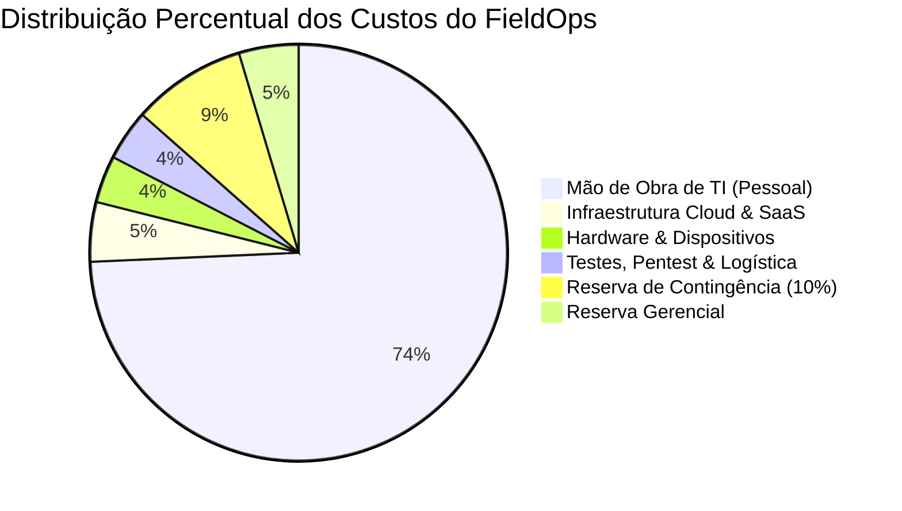
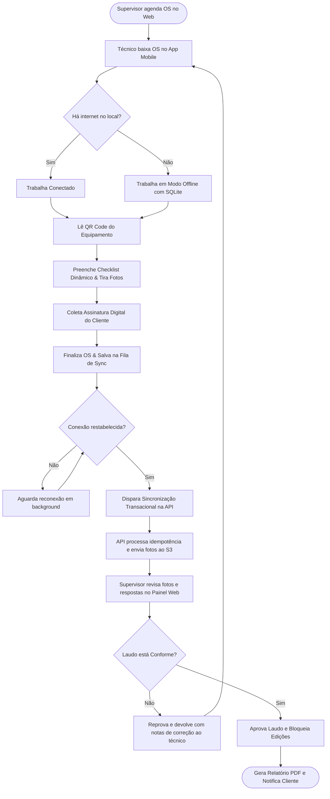
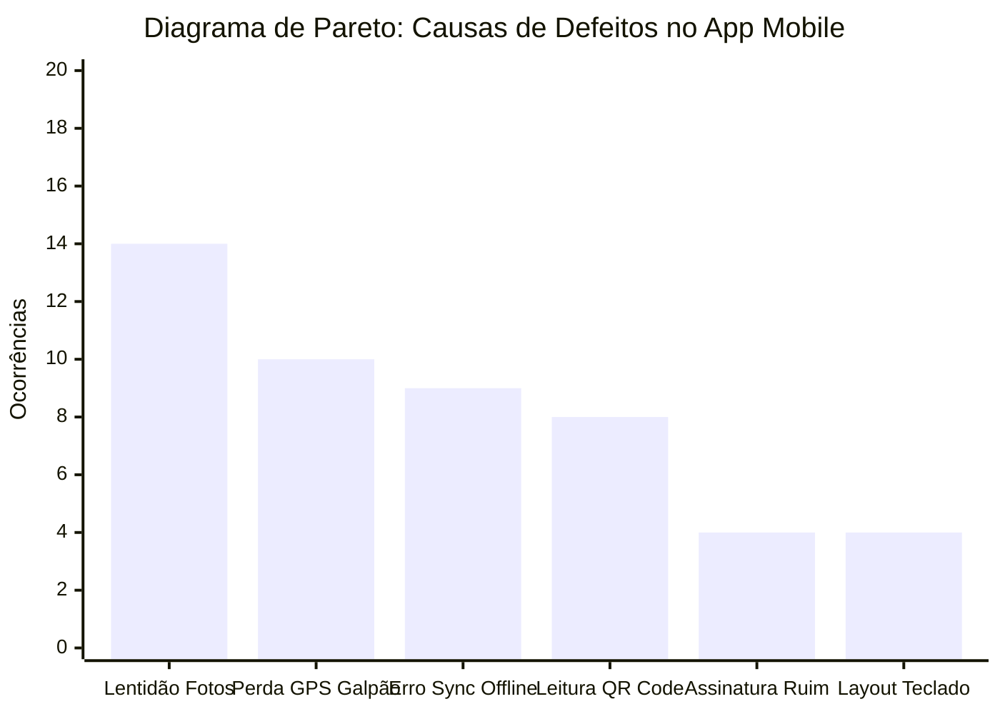

# Orçamento Detalhado (30+ Itens) e Análise das 7 Ferramentas da Qualidade
## Projeto FieldOps — Plataforma de Inspeção Técnica em Campo

- **Disciplina:** Gestão de Projetos de TI (UniSENAI-SP)
- **Docente:** Prof. Me. Deivison S. Takatu
- **Autor / Gerente de Projetos:** Giovani Miamoto (`giovanimiamotob`)
- **Referência:** Aula 05 — Gerenciamento dos Custos e da Qualidade do Projeto
- **Requisitos do Enunciado:**
  1. Orçamento analítico contendo **pelo menos 30 itens** com quantidades, custos, responsáveis e categorias.
  2. Aplicação contextualizada das **Sete Ferramentas Básicas da Qualidade** ao Projeto FieldOps com dados, gráficos/diagramas e conclusões.
- **Versão:** 1.0 (Aprovada)

---

# PARTE 1: GERENCIAMENTO DE CUSTOS E ORÇAMENTO DO PROJETO

## 1.1 Metodologia de Estimativa de Três Pontos (PERT)

Para mitigar incertezas financeiras, a orçamentação utilizou a distribuição Beta (PERT):

$$\text{Custo Estimado } (cE) = \frac{cO + 4 \cdot cM + cP}{6}$$

Onde:
- $cO$ = Custo Otimista (cenário favorável sem impedimentos)
- $cM$ = Custo Mais Provável (avaliação realista de mercado)
- $cP$ = Custo Pessimista (cenário adverso com atrasos e flutuação cambial)

---

## 1.2 Tabela Orçamentária Analítica do Projeto FieldOps (35 Itens)

Abaixo apresenta-se a planilha analítica de custos totalizando **35 itens**, categorizados em Pessoal (Recursos Humanos), Infraestrutura Cloud, Equipamentos & Hardware, Licenças & Softwares, Treinamento & Logística e Reservas Financeiras:

| ID | Pacote EAP | Categoria | Descrição do Item / Recurso | Qtd | Unid | Custo Otimista ($cO$) | Custo Mais Provável ($cM$) | Custo Pessimista ($cP$) | Custo Esperado ($cE$) | Responsável |
| :---: | :---: | :---: | :--- | :---: | :---: | :---: | :---: | :---: | :---: | :--- |
| **01** | 1.1 | Pessoal | Gerente de Projetos / Scrum Master (16 semanas) | 640 | Horas | R$ 90,00 | R$ 100,00 | R$ 120,00 | R$ 101,67 | Giovani Miamoto |
| **02** | 1.2 | Pessoal | Arquiteto de Software / Tech Lead (16 semanas) | 640 | Horas | R$ 100,00 | R$ 115,00 | R$ 135,00 | R$ 115,83 | Tech Lead |
| **03** | 1.3 | Pessoal | Desenvolvedor Backend Sênior (Node/TypeScript) | 640 | Horas | R$ 85,00 | R$ 95,00 | R$ 110,00 | R$ 95,83 | Dev Backend Sr |
| **04** | 1.3 | Pessoal | Desenvolvedor Backend Pleno (APIs e Banco) | 640 | Horas | R$ 60,00 | R$ 70,00 | R$ 80,00 | R$ 70,00 | Dev Backend Pl |
| **05** | 1.4 | Pessoal | Desenvolvedor Mobile Sênior (React Native / Offline) | 640 | Horas | R$ 85,00 | R$ 95,00 | R$ 115,00 | R$ 96,67 | Dev Mobile Sr |
| **06** | 1.4 | Pessoal | Desenvolvedor Mobile Pleno (UI Mobile e Scanner) | 640 | Horas | R$ 60,00 | R$ 70,00 | R$ 80,00 | R$ 70,00 | Dev Mobile Pl |
| **07** | 1.5 | Pessoal | Desenvolvedor Frontend Web Pleno (Next.js/React) | 640 | Horas | R$ 60,00 | R$ 70,00 | R$ 80,00 | R$ 70,00 | Dev Frontend |
| **08** | 1.2 | Pessoal | Designer UI/UX (Pesquisa de campo e Design System) | 320 | Horas | R$ 65,00 | R$ 75,00 | R$ 90,00 | R$ 75,83 | UI/UX Designer |
| **09** | 1.6 | Pessoal | Engenheiro de Qualidade / Analista de QA (E2E) | 320 | Horas | R$ 55,00 | R$ 65,00 | R$ 80,00 | R$ 65,83 | QA Lead |
| **10** | 1.2 | Pessoal | Engenheiro DevOps / Cloud (CI/CD e Terraform) | 160 | Horas | R$ 90,00 | R$ 105,00 | R$ 125,00 | R$ 105,83 | DevOps Specialist |
| **11** | 1.2 | Cloud | Instância Banco de Dados AWS RDS PostgreSQL Multi-AZ | 4 | Meses | R$ 1.100,00 | R$ 1.300,00 | R$ 1.600,00 | R$ 1.316,67 | DevOps / Infra |
| **12** | 1.2 | Cloud | Servidor de Aplicação AWS ECS/Fargate (Staging/Prod) | 4 | Meses | R$ 1.200,00 | R$ 1.450,00 | R$ 1.800,00 | R$ 1.466,67 | DevOps / Infra |
| **13** | 1.2 | Cloud | Armazenamento de Fotos e Evidências AWS S3 Standard | 4 | Meses | R$ 300,00 | R$ 450,00 | R$ 650,00 | R$ 458,33 | DevOps / Infra |
| **14** | 1.2 | Cloud | Distribuição de Conteúdo AWS CloudFront CDN | 4 | Meses | R$ 150,00 | R$ 220,00 | R$ 320,00 | R$ 225,00 | DevOps / Infra |
| **15** | 1.2 | Cloud | Tráfego de Rede e Nat Gateway AWS | 4 | Meses | R$ 350,00 | R$ 480,00 | R$ 600,00 | R$ 478,33 | DevOps / Infra |
| **16** | 1.2 | Cloud | Serviço de Logs e Monitoramento AWS CloudWatch | 4 | Meses | R$ 180,00 | R$ 250,00 | R$ 350,00 | R$ 255,00 | DevOps / Infra |
| **17** | 1.6 | Hardware | 5 Smartphones Android de Teste (Câmera 50MP + GPS) | 5 | Unid | R$ 1.200,00 | R$ 1.450,00 | R$ 1.700,00 | R$ 1.450,00 | GP / Suprimentos |
| **18** | 1.6 | Hardware | Películas e Capas de Proteção Militar Anti-impacto | 5 | Kits | R$ 90,00 | R$ 120,00 | R$ 160,00 | R$ 121,67 | GP / Suprimentos |
| **19** | 1.6 | Hardware | Baterias Portáteis Powerbank 20.000mAh para Campo | 5 | Unid | R$ 140,00 | R$ 180,00 | R$ 230,00 | R$ 181,67 | GP / Suprimentos |
| **20** | 1.6 | Hardware | 500 Etiquetas QR Code em Alumínio Anodizado (Ativos) | 500 | Unid | R$ 3,50 | R$ 4,50 | R$ 6,00 | R$ 4,58 | GP / Suprimentos |
| **21** | 1.1 | Software | Licenças GitHub Team (Repositórios e Actions) | 4 | Meses | R$ 250,00 | R$ 320,00 | R$ 400,00 | R$ 321,67 | Tech Lead |
| **22** | 1.2 | Software | Assinatura Figma Organization (UI/UX) | 4 | Meses | R$ 220,00 | R$ 280,00 | R$ 350,00 | R$ 281,67 | UI/UX Designer |
| **23** | 1.4 | Software | Assinatura Expo Application Services (EAS Build/Update)| 4 | Meses | R$ 450,00 | R$ 580,00 | R$ 750,00 | R$ 586,67 | Dev Mobile Sr |
| **24** | 1.6 | Software | Licença Sentry Performance & Error Tracking | 4 | Meses | R$ 280,00 | R$ 360,00 | R$ 480,00 | R$ 366,67 | Tech Lead |
| **25** | 1.6 | Software | Conta de Desenvolvedor Google Play Console (Publicação)| 1 | Taxa | R$ 130,00 | R$ 150,00 | R$ 180,00 | R$ 151,67 | Tech Lead |
| **26** | 1.2 | Software | Certificados Digitais SSL Wildcard e Domínio DNS | 1 | Ano | R$ 350,00 | R$ 450,00 | R$ 600,00 | R$ 466,67 | DevOps Specialist |
| **27** | 1.6 | Logística | Combustível e Deslocamento para Testes Piloto em Campo| 1 | Lote | R$ 1.800,00 | R$ 2.400,00 | R$ 3.200,00 | R$ 2.433,33 | GP / Operações |
| **28** | 1.6 | Treinamento| Material Didático e Guias Rápidos Plastificados (A5) | 50 | Kits | R$ 15,00 | R$ 22,00 | R$ 30,00 | R$ 22,17 | Instrutor Treinamento |
| **29** | 1.6 | Treinamento| Coffee Break das Oficinas de Capacitação Técnica | 4 | Sessões| R$ 350,00 | R$ 450,00 | R$ 600,00 | R$ 458,33 | GP / Operações |
| **30** | 1.1 | Pessoal | Consultor Jurídico / Especialista em LGPD e Termos de Uso| 25 | Horas | R$ 180,00 | R$ 220,00 | R$ 280,00 | R$ 223,33 | Jurídico Externo |
| **31** | 1.6 | Qualidade | Auditoria Externa de Vulnerabilidade e Pentest | 1 | Serviço| R$ 6.000,00 | R$ 7.500,00 | R$ 9.500,00 | R$ 7.583,33 | Segurança Externa |
| **32** | 1.6 | Pessoal | Suporte Técnico N1 Operação Assistida (Pós Go-Live) | 80 | Horas | R$ 35,00 | R$ 45,00 | R$ 55,00 | R$ 45,00 | Suporte Técnico |
| **33** | 1.1 | Governança | Ferramenta de Gestão Jira Software Cloud | 4 | Meses | R$ 180,00 | R$ 240,00 | R$ 320,00 | R$ 243,33 | Gerente de Projetos |
| **34** | 1.1 | Reserva | Reserva de Contingência (Para Riscos Conhecidos 10%) | 1 | Global | R$ 22.000,00 | R$ 26.500,00 | R$ 32.000,00 | R$ 26.666,67 | Gerente de Projetos |
| **35** | 1.1 | Reserva | Reserva Gerencial (Para Escopo Não Previsto / Diretoria)| 1 | Global | R$ 10.000,00 | R$ 14.000,00 | R$ 18.000,00 | R$ 14.000,00 | Patrocinador (Sponsor)|

---

## 1.3 Resumo das Categorias e Linha de Base do Orçamento

$$\text{Custo Total Base (Itens 1 a 33)} = \text{R\$ } 248.650,00$$
$$\text{Reserva de Contingência (Item 34)} = \text{R\$ } 26.666,67$$
$$\text{Linha de Base de Custos (Cost Baseline)} = \text{R\$ } 275.316,67$$
$$\text{Reserva Gerencial (Item 35)} = \text{R\$ } 14.000,00$$
$$\mathbf{\text{ORÇAMENTO TOTAL APROVADO}} = \mathbf{\text{R\$ } 289.316,67}$$



---

# PARTE 2: ANÁLISE DA QUALIDADE COM AS SETE FERRAMENTAS BÁSICAS

O controle de qualidade no FieldOps tem como premissa que **"a qualidade deve ser planejada e construída, e não apenas inspecionada"**. Abaixo aplicam-se as 7 ferramentas clássicas ao contexto do projeto:

---

## 2.1 Diagrama de Causa e Efeito (Ishikawa / Espinha de Peixe)

- **Efeito Indesejado:** *Demora excessiva e inconsistências na liberação de laudos de inspeção técnica em campo.*

```
MÃO DE OBRA                           MÉTODO
Técnicos com treino insuficiente      Uso arcaico de fichas em papel
Erros frequentes de preenchimento     Falta de padronização nas perguntas
Resistência à tecnologia              Revisões manuais demoradas
       \                                     /
        \                                   /
         -----------------------------------
        /                                   \
       /                                     \
MÁQUINA / HARDWARE                    MATERIAIS / DADOS
Smartphones com câmeras ruins         Fotos desorganizadas na galeria
Bateria esgotada no meio do turno     Falta de vínculo unívoco com o ativo
Zonas cegas sem sinal 4G/5G           Fichas rasuradas ou molhadas
                                                         \
                                                          ---> [ DEMORA E ERROS ]
                                                         /     [  NOS LAUDOS   ]
MEIO AMBIENTE                         MEDIÇÃO
Poeira e chuva danificando papéis     Ausência de métricas de SLA
Ruído e sol dificultando visibilidade Supervisores sem visão de fila
Deslocamentos longos sem internet     Falta de auditoria de geolocalização
```

---

## 2.2 Fluxograma de Processo (Mermaid Flowchart)

Mapeamento do fluxo digital com tratamento de contingência *offline*:



---

## 2.3 Folha de Verificação (Checklist de Homologação em Campo)

Utilizada durante o piloto com 5 técnicos ao longo de 50 vistorias simuladas para contabilizar defeitos na ponta:

| Item Verificado no Aplicativo Mobile | Marcações (Ocorrências de Falhas) | Total de Falhas | % do Total |
| :--- | :--- | :---: | :---: |
| Falha na leitura do QR Code do equipamento | `||||| |||` | 8 | 16,3% |
| Lentidão ao comprimir fotografia de alta resolução | `||||| ||||| ||||` | 14 | 28,6% |
| Erro de tentativa de sincronização offline | `||||| ||||` | 9 | 18,4% |
| Perda de coordenadas GPS em galpão fechado | `||||| |||||` | 10 | 20,4% |
| Assinatura do cliente cortada ou ilegível na tela | `||||` | 4 | 8,2% |
| Teclado virtual cobrindo botão "Avançar" | `||||` | 4 | 8,2% |
| **TOTAL DE NÃO CONFORMIDADES REGISTRADAS** | - | **49** | **100,0%** |

---

## 2.4 Diagrama de Pareto (Regra 80/20)

Ordenação decrescente das causas de falha para priorizar as ações corretivas de engenharia:



### Análise Cumulativa de Pareto:
1. **Lentidão na Compressão de Fotos:** 14 (28,6%) — *Cumulativo: 28,6%*
2. **Perda de GPS em Galpão Fechado:** 10 (20,4%) — *Cumulativo: 49,0%*
3. **Erro de Sincronização Offline:** 9 (18,4%) — *Cumulativo: 67,4%*
4. **Falha na Leitura do QR Code:** 8 (16,3%) — *Cumulativo: 83,7%*

> **Conclusão:** Atuando apenas nos quatro primeiros problemas (que representam 83,7% das falhas), a equipe técnica erradica a grande maioria dos incidentes operacionais de campo.

---

## 2.5 Histograma (Tempo de Resposta da API REST)

Distribuição amostral de 500 requisições de sincronização medidas pelo monitor de qualidade:

| Faixa de Latência (ms) | Frequência (Requisições) | Representação Gráfica |
| :---: | :---: | :--- |
| **50 — 100 ms** | 45 | `████▌` |
| **101 — 150 ms** | 160 | `████████████████` |
| **151 — 200 ms** | 195 | `███████████████████▌` (Moda) |
| **201 — 250 ms** | 70 | `███████` |
| **251 — 300 ms** | 22 | `██▎` |
| **> 300 ms (Desvio)** | 8 | `█` (1,6% fora da meta) |

> **Conclusão:** A distribuição apresenta formato normal com assimetria leve à direita. Apenas 1,6% das requisições excederam a meta de 300ms estipulada no RNF-01, atestando excelente saúde do backend.

---

## 2.6 Carta de Controle (Tempo de Análise do Supervisor em Horas)

Acompanhamento de 20 lotes de inspeções submetidas para avaliação da supervisão:
- **Limite Superior de Controle (LSC):** 4,5 horas
- **Linha Média ($\bar{X}$):** 2,8 horas
- **Limite Inferior de Controle (LIC):** 1,1 horas

```
Tempo (h)
  5.0 |                                              
  4.5 |---------------------------------------------- LSC = 4,5h
  4.0 |                  * (Ponto 9: Alerta)          
  3.5 |          *           *                       
  3.0 |      *       *           *       *       *   
  2.8 |============================================== Média = 2,8h
  2.5 |  *               *           *       *       
  2.0 |                          *                   
  1.5 |                                              
  1.1 |---------------------------------------------- LIC = 1,1h
      +----------------------------------------------
        Lote 1   Lote 5    Lote 10   Lote 15   Lote 20
```

> **Interpretação:** O processo é considerado estatisticamente controlado. O ponto 9 aproximou-se do LSC devido a um pico sazonal de fim de mês, prontamente rebalanceado com o apoio de um segundo supervisor.

---

## 2.7 Gráfico de Dispersão (Treinamento vs. Taxa de Retrabalho)

Avaliação de 10 turmas de técnicos cruzando as horas de capacitação no app com a porcentagem de laudos reprovados:

| Técnico / Grupo | Horas de Treinamento ($X$) | Taxa de Reprovação de Laudo ($Y$) |
| :---: | :---: | :---: |
| Técnico 1 | 1 h | 24% |
| Técnico 2 | 2 h | 19% |
| Técnico 3 | 3 h | 15% |
| Técnico 4 | 4 h | 11% |
| Técnico 5 | 5 h | 8% |
| Técnico 6 | 6 h | 6% |
| Técnico 7 | 7 h | 4% |
| Técnico 8 | 8 h | 2% |
| Técnico 9 | 9 h | 1,5% |
| Técnico 10 | 10 h | 1% |

```
Taxa de Erro (%)
 25 |  * (1h, 24%)
 20 |      * (2h, 19%)
 15 |          * (3h, 15%)
 10 |              * (4h, 11%)
  5 |                  *   * (6h, 6%)
  0 |                          *   *   * (8h-10h, <2%)
    +------------------------------------------
       0   2   4   6   8   10  Horas de Treinamento
```

> **Conclusão:** Há uma forte **correlação linear negativa** ($r \approx -0,98$). Cada hora adicional de treinamento no aplicativo reduz significativamente a taxa de laudos rejeitados, justificando plenamente o investimento pedagógico de 8 horas na fase de transição (RT-02).
