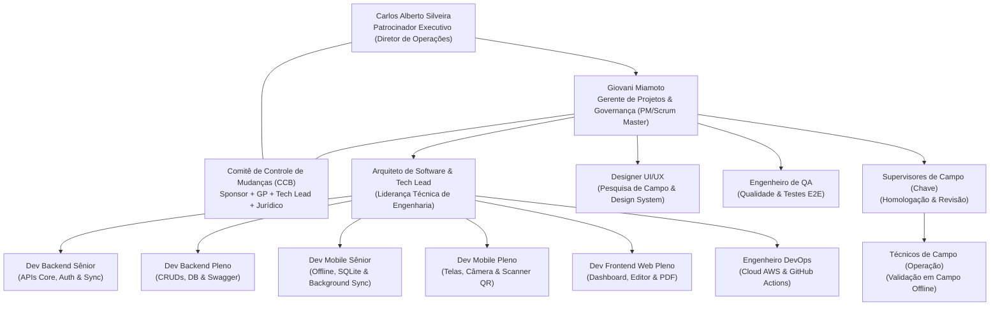

# Recursos Humanos (Organograma e Matriz RACI) e Plano de Comunicação
## Projeto FieldOps — Plataforma de Inspeção Técnica em Campo

- **Disciplina:** Gestão de Projetos de TI (UniSENAI-SP)
- **Docente:** Prof. Me. Deivison S. Takatu
- **Autor / Gerente de Projetos:** Giovani Miamoto (`giovanimiamotob`)
- **Referência:** Aula 06 — Gerenciamento de Recursos Humanos e Comunicações
- **Requisitos do Enunciado:**
  1. Elaborar o Organograma funcional e a Matriz RACI detalhada para o Projeto FieldOps.
  2. Elaborar o Plano de Comunicação com destinatários, responsáveis, canais, frequência, formato e momentos de realização.
- **Versão:** 1.0 (Aprovada)

---

# PARTE 1: GERENCIAMENTO DE RECURSOS HUMANOS

## 1.1 Organograma Funcional do Projeto FieldOps

A estrutura organizacional do projeto adota uma abordagem matricial equilibrada, articulando a liderança executiva da empresa contratante com o time multidisciplinar de engenharia de software:



---

## 1.2 Descrição de Papéis e Responsabilidades

| Papel no Projeto | Titular / Perfil | Principais Responsabilidades |
| :--- | :--- | :--- |
| **Patrocinador Executivo (*Sponsor*)** | Carlos Alberto Silveira | Liberação de verbas, aprovação do TAP, mediação executiva e validação final do aceite da plataforma. |
| **Gerente de Projetos (PM)** | Giovani Miamoto | Planejamento, controle de custos e prazos, facilitação ágil, gestão de riscos, comunicação com stakeholders e garantia do cumprimento do escopo. |
| **Tech Lead / Arquiteto** | Especialista Sênior | Desenho da arquitetura distribuída, definição de padrões de código, auditoria de segurança e aprovação de Pull Requests críticos. |
| **Designer UI/UX** | Especialista Pleno | Entrevistas com operadores de campo, prototipação no Figma, testes de usabilidade e especificação das diretrizes visuais para uso sob sol/chuva. |
| **Equipe Backend (Sr / Pl)** | Desenvolvedores Node/Postgres | Desenvolvimento da API REST, mecanismos de idempotência, modelos de checklists dinâmicos e integrações de nuvem. |
| **Equipe Mobile (Sr / Pl)** | Desenvolvedores React Native | Implementação do app Android, banco SQLite local, rotinas de captura de câmera/GPS e sincronização assíncrona *offline-first*. |
| **Desenvolvedor Frontend** | Desenvolvedor Next.js | Criação do painel web de supervisão, construtor de formulários dinâmicos, relatórios e dashboards analíticos. |
| **Engenheiro de QA** | Analista de Testes | Elaboração de planos de teste, automação E2E (Cypress/Appium), validação de casos de perda de conexão e carga. |
| **DevOps Specialist** | Engenheiro Cloud | Gestão de infraestrutura como código (Terraform), pipelines de CI/CD, monitoramento e configuração de ambientes de nuvem. |
| **Supervisores / Técnicos Piloto** | Equipe Operacional Real | Execução dos testes em campo, validação da aderência das telas e feedback contínuo durante os pilotos quinzenais. |

---

## 1.3 Matriz de Responsabilidades (RACI)

Convenção:
- **R (Responsible):** Quem executa a atividade (o "fazedor").
- **A (Accountable):** Quem responde pelo resultado e tem autoridade de aprovação final (apenas um "A" por linha).
- **C (Consulted):** Quem deve ser consultado antes da decisão ou conclusão (comunicação bidirecional).
- **I (Informed):** Quem deve ser mantido informado sobre o andamento e conclusão (comunicação unidirecional).

| Entregável / Atividade do Projeto | Sponsor | GP | Tech Lead | UI/UX | Dev Backend | Dev Mobile | Dev Web | QA | DevOps | Supervisores / Técnicos |
| :--- | :---: | :---: | :---: | :---: | :---: | :---: | :---: | :---: | :---: | :---: |
| **Elaboração e Aprovação do TAP** | **A** | **R** | C | I | I | I | I | I | I | C |
| **Detalhamento de Escopo e EAP** | I | **A/R** | C | C | C | C | C | C | C | C |
| **Cronograma e Linha de Base** | I | **A/R** | C | I | C | C | C | C | C | I |
| **Pesquisa e Entrevistas de Campo** | I | A | C | **R** | I | I | I | I | I | C |
| **Protótipos de Alta Fidelidade Figma** | I | A | C | **R** | I | C | C | I | I | C |
| **Modelagem do Banco PostgreSQL** | I | A | **A/R** | I | **R** | C | C | I | I | I |
| **Infraestrutura Cloud & CI/CD** | I | A | C | I | I | I | I | I | **R** | I |
| **API REST: Auth JWT & RBAC** | I | A | C | I | **R** | I | I | C | I | I |
| **API REST: Motor de Checklist** | I | A | C | I | **R** | C | C | C | I | I |
| **API REST: Motor de Sincronização**| I | A | **A** | I | **R** | C | I | C | I | I |
| **App Mobile: Banco SQLite Offline**| I | A | C | I | I | **R** | I | C | I | I |
| **App Mobile: Checklist & Câmera** | I | A | C | C | I | **R** | I | C | I | C |
| **App Mobile: Fila de Sync Offline**| I | A | **A** | I | C | **R** | I | C | I | I |
| **Web Admin: CRUDs e Dashboard** | I | A | C | C | I | I | **R** | C | I | C |
| **Web Admin: Revisão & Emissor PDF** | I | A | C | C | I | I | **R** | C | I | C |
| **Automação de Testes E2E** | I | A | C | I | C | C | C | **R** | C | I |
| **Homologação Piloto em Campo (UAT)**| I | **A** | C | C | I | C | I | C | I | **R** |
| **Treinamento Operacional dos Usuários**| I | **A/R**| I | C | I | I | I | I | I | **R** |
| **Deploy em Produção (Go-Live)** | **A** | C | C | I | I | I | I | C | **R** | I |
| **Aceite Formal do Projeto** | **A** | **R** | C | I | I | I | I | I | I | C |

---

# PARTE 2: PLANO DE GERENCIAMENTO DAS COMUNICAÇÕES

## 2.1 Princípios e Diretrizes de Comunicação

O Plano de Comunicações garante que a informação certa chegue à pessoa certa, no momento oportuno, pelo canal adequado e com o menor ruído possível.
- **Transparência Radical:** Impedimentos técnicos e desvios de cronograma devem ser comunicados de imediato, sem filtragens cosméticas.
- **Canais Padronizados:** É estritamente vedada a tomada de decisões de escopo ou arquitetura via mensagens informais de WhatsApp; todas as deliberações devem ser registradas em atas no Notion/Jira.

---

## 2.2 Matriz 5W2H do Plano de Comunicação

Abaixo detalham-se todos os rituais e fluxos informacionais do Projeto FieldOps:

| O Que Comunicar? (*What*) | Por Que Comunicar? (*Why*) | Quem Comunica? (*Who*) | Para Quem? (*To Whom*) | Quando / Frequência (*When*) | Onde / Canal (*Where*) | Formato / Como (*How*) | Momento de Realização |
| :--- | :--- | :--- | :--- | :--- | :--- | :--- | :--- |
| **Reunião de Kick-off** | Alinhar expectativas, escopo e metas do projeto | Gerente de Projetos | Toda a equipe, Sponsor e Stakeholders | Início do Projeto (Semana 1) | Microsoft Teams / Presencial | Apresentação de slides executivos e ata formal | Abertura do Projeto |
| **Reunião Diária (*Daily Scrum*)** | Identificar impedimentos e sincronizar tarefas técnicas | Equipe Técnica / Scrum Master | Time de Desenvolvimento e QA | Diariamente às 09:00 (15 minutos) | Canal de voz Discord / Slack Huddle | Comunicação verbal síncrona (O que fiz, o que farei, impedimentos) | Durante as Sprints |
| **Refinamento e Planejamento de Sprint** | Estimar esforço e definir o escopo da próxima iteração | Gerente de Projetos & Tech Lead | Time de Desenvolvimento | Quinzenalmente (segunda-feira) | Google Meet + Jira Software | Análise de histórias de usuário e Planning Poker | Início de cada Sprint |
| **Revisão e Demonstração da Sprint** | Apresentar incrementos funcionais operacionais | Time de Desenvolvimento | Gerente de Projetos, Sponsor e Supervisores | Quinzenalmente (sexta-feira) | Google Meet / Híbrido | Demonstração ao vivo do software rodando em ambiente de Staging | Final de cada Sprint |
| **Retrospectiva da Sprint** | Avaliar processos internos e promover melhoria contínua | Scrum Master / GP | Time de Desenvolvimento | Quinzenalmente (após a Review) | Ferramenta Miro / Metro Retro | Quadro visual colaborativo com planos de ação | Final de cada Sprint |
| **Relatório Executivo de Progresso (*Status Report*)** | Reportar avanço físico-financeiro, EVM e riscos | Gerente de Projetos | Patrocinador Executivo e Diretoria | Mensalmente (1º dia útil) | E-mail formal com PDF anexo | Documento consolidado (Curva S, SPI, CPI e semáforo de riscos) | Fechamento mensal |
| **Solicitações de Mudança (*Change Request*)** | Formalizar pedidos de alteração de escopo/prazo | Qualquer Stakeholder | Comitê de Mudanças (CCB) | Sob demanda (quando necessário) | Portal Jira Service Desk | Formulário padrão de análise de impacto técnico e custo | Imediatamente ao surgir o desvio |
| **Alerta de Incidentes Críticos / Blocker** | Resolver falhas que travam a linha de produção/testes | Quem identificar o incidente | Gerente de Projetos e Tech Lead | Imediato (tolerância máxima 15 min) | Canal `#urgente-blockers` no Slack + Ligação | Mensagem com tags `@channel`, logs de erro e severidade | Ocorrência de incidentes |
| **Boletim de Lançamento (*Release Notes*)** | Informar novas funcionalidades e correções publicadas | Tech Lead / DevOps | Supervisores, Técnicos e Suporte | A cada deploy em Staging/Produção | E-mail informativo e Wiki do projeto | Tabela resumida de melhorias e instruções de atualização | Pós-deploy |
| **Reunião de Aceite Final e Lições Aprendidas** | Formalizar o encerramento do projeto e registrar aprendizados | Gerente de Projetos | Toda a equipe e Patrocinador | Fim da Semana 16 | Reunião plenária presencial | Ata formal de encerramento e Termo de Aceite assinado | Encerramento do Projeto |

---

## 2.3 Matriz de Escalonamento de Conflitos e Problemas

Caso um impedimento técnico ou conflito interpessoal não seja equacionado em seu nível de origem, aplica-se a seguinte régua de escalonamento temporal:

```
[ Nível 1: Desenvolvedor / QA ]
         | (Se não resolvido em até 4 horas úteis)
         v
[ Nível 2: Tech Lead & Gerente de Projetos ]
         | (Se envolver desvio de prazo > 3 dias ou custo > R$ 5.000)
         v
[ Nível 3: Comitê de Mudanças (CCB) & Patrocinador Executivo ]
```
