# Gerenciamento de Riscos do Projeto FieldOps
## Identificação, Análise Qualitativa, Matriz 5x5 e Planos de Resposta

- **Disciplina:** Gestão de Projetos de TI (UniSENAI-SP)
- **Docente:** Prof. Me. Deivison S. Takatu
- **Autor / Gerente de Projetos:** Giovani Miamoto (`giovanimiamotob`)
- **Referência:** Aula 07 — Gerenciamento de Riscos do Projeto
- **Requisito do Enunciado:** Identificação analítica de causas, eventos de risco e consequências, matriz probabilidade x impacto, estratégias de resposta (evitar, mitigar, transferir, aceitar), gatilhos e donos de risco.
- **Versão:** 1.0 (Aprovada)

---

## 1. Estrutura Analítica dos Riscos (EAR / RBS)

Os riscos do Projeto FieldOps foram agrupados hierarquicamente em quatro macrocategorias:

```mermaid
graph TD
    EAR["EAR - Riscos do Projeto FieldOps"]
    
    TEC["1.0 Riscos Técnicos & Arquitetura"]
    ORG["2.0 Riscos Organizacionais & Pessoas"]
    GER["3.0 Riscos de Gerenciamento & Prazos"]
    EXT["4.0 Riscos Externos & Conformidade"]

    EAR --> TEC
    EAR --> ORG
    EAR --> GER
    EAR --> EXT

    TEC --> T1["1.1 Falha de Sincronização Concorrente Offline"]
    TEC --> T2["1.2 Perda de Sinal GPS e Bloqueio de Câmera"]
    TEC --> T3["1.3 Estouro de Quota de Armazenamento de Fotos"]
    TEC --> T4["1.4 Vulnerabilidade de Segurança em APIs Expostas"]

    ORG --> O1["2.1 Resistência de Técnicos à Mudança Digital"]
    ORG --> O2["2.2 Turnover de Desenvolvedor Mobile Especialista"]
    ORG --> O3["2.3 Indisponibilidade de Supervisores para Homologação"]

    GER --> G1["3.1 Subestimativa de Esforço no Motor Dinâmico"]
    GER --> G2["3.2 Scope Creep (Adição de Rastreio em Tempo Real)"]
    GER --> G3["3.3 Atraso na Aquisição dos Aparelhos Android Piloto"]

    EXT --> E1["4.1 Não Conformidade com LGPD nas Fotos de Assinaturas"]
    EXT --> E2["4.2 Instabilidade ou Queda de Conexão na Nuvem AWS"]
    EXT --> E3["4.3 Flutuação Cambial nos Custos dos Serviços Cloud"]
```



---

## 2. Critérios de Avaliação e Escalas de Severidade

Em consonância com as diretrizes do PMBOK ministradas na Aula 07:

### 2.1 Escala de Probabilidade ($P$)
- **1 (Muito Baixa - 10%):** Altamente improvável durante o ciclo de vida.
- **2 (Baixa - 30%):** Ocorrência pontual e esporádica.
- **3 (Média - 50%):** Ocorrência provável em projetos com similaridade técnica.
- **4 (Alta - 70%):** Grande histórico de incidência em operações de campo.
- **5 (Muito Alta - 90%):** Quase certeza de ocorrência sem ação preventiva ativa.

### 2.2 Escala de Impacto ($I$) nos Quatro Objetivos
- **1 (Insignificante):** Impacto financeiro < R$ 2.000 ou atraso < 2 dias.
- **2 (Baixo):** Aumento < 10% de custos ou desvio < 5 dias úteis de cronograma.
- **3 (Moderado):** Aumento de 10-20% em custos, desvio de 5-10 dias ou degradação parcial de escopo secundário.
- **4 (Alto):** Aumento de 20-40% em custos, atraso de 10-20 dias ou impacto em requisitos funcionais críticos.
- **5 (Crítico):** Atraso superior a 20 dias úteis, estouro orçamentário > 40% ou inviabilização do produto final.

$$\text{Severidade / Score} = \text{Probabilidade } (P) \times \text{Impacto Médio } (I)$$

---

## 3. Matriz de Riscos 5x5 do Projeto FieldOps

```
PROBABILIDADE (P)
  5 (Muito Alta)|    [R11]         [R01]          [R02]
  4 (Alta)      |    [R09]         [R07]          [R03]
  3 (Média)     |    [R12]  [R08]  [R05]   [R04]
  2 (Baixa)     |    [R14]  [R13]  [R06]   [R10]
  1 (Muito Baix)|    [R16]  [R15]
                +-----------------------------------------
                  1       2      3       4       5
                             IMPACTO (I)

Zonas de Risco:
  [ 1 a 4 ]   Verde  - Risco Baixo (Monitorar / Aceitar)
  [ 5 a 11 ]  Amarelo - Risco Médio (Mitigar com Planos Operacionais)
  [ 12 a 25 ] Vermelho - Risco Crítico / Alto (Atenção Executiva Obrigatória)
```

---

## 4. Registro Detalhado de Riscos e Planos de Ação (16 Riscos)

| ID | Causa Raiz | Evento de Risco | Consequência | P | I | Score | Prioridade | Estratégia | Ações Preventivas & Mitigadoras | Gatilho (*Trigger*) | Plano de Contingência | Dono do Risco |
| :---: | :--- | :--- | :--- | :---: | :---: | :---: | :---: | :---: | :--- | :--- | :--- | :--- |
| **R01** | Operação concorrente em áreas desconectadas | Conflito de dados no momento da sincronização com o PostgreSQL | Perda de preenchimentos de checklists ou sobreposição indevida | 5 | 4 | **20** | **1º (Crítica)** | **Mitigar** | Arquitetura com bloqueio de edição no servidor quando a OS for baixada para campo + chave de idempotência `client_uuid`. | Erro HTTP 409 (Conflict) no endpoint `/sync`. | Criação de versão com sufixo `_revisada_campo` e notificação ao supervisor para desempate manual. | Dev Backend Sr |
| **R02** | Dependência de operadoras 4G em áreas remotas | Lentidão ou falha de transmissão do aplicativo móvel | Acúmulo de vistorias pendentes no celular e atraso no laudo | 5 | 4 | **20** | **2º (Crítica)** | **Mitigar** | Arquitetura nativa *offline-first* em SQLite; compressão local de fotos para menos de 600KB antes de subir. | Fila local com mais de 5 inspeções retidas por mais de 4 horas. | Disparo de alerta no app sugerindo conexão à rede Wi-Fi da filial/hotel ao final do dia. | Dev Mobile Sr |
| **R03** | Falta de hábito digital de operadores antigos | Resistência de técnicos ao abandono das fichas de papel | Boicote ao uso do app, atraso na digitação e reclamações | 4 | 4 | **16** | **3º (Alta)** | **Mitigar** | Envolver 3 técnicos líderes na co-criação das telas; interface limpa com botões grandes de seleção direta. | Índice de adesão no piloto < 70% das ordens geradas. | Programa de apadrinhamento técnico (*buddy system*) e premiação simbólica de produtividade digital. | Gerente de Projetos |
| **R04** | Complexidade do gerador de checklists | Erros de renderização de tipos de dados mistos no mobile | App fecha inesperadamente (*crash*) durante preenchimento | 3 | 4 | **12** | **4º (Alta)** | **Prevenir** | Testes automatizados com fixtures abrangendo todos os 10 tipos de campos suportados antes de cada release. | Mais de 2 relatórios de falha no Sentry na mesma semana. | Rollback imediato para a versão estável anterior via Expo OTA Updates. | Tech Lead |
| **R05** | Ambientes industriais ruidosos e reflexivos | Câmera do smartphone não consegue escanear o QR Code sujo | Técnico não consegue iniciar a vistoria no ativo correto | 3 | 3 | **9** | **5º (Média)** | **Mitigar** | Utilizar biblioteca de scan de alto contraste (ZXing otimizada) + permitir digitação manual do serial do ativo com justificativa. | Técnico clicar em "Não foi possível ler QR Code". | O técnico deve tirar foto obrigatória da placa de identificação do ativo para auditoria posterior. | Dev Mobile Pl |
| **R06** | Mercado de TI aquecido para desenvolvedores móveis | Saída repentina do Desenvolvedor Mobile Sênior da equipe | Paralisação temporária da frente de sincronização do aplicativo | 2 | 4 | **8** | **6º (Média)** | **Mitigar** | Pareamento contínuo de código com o Desenvolvedor Pleno e documentação rigorosa da arquitetura no repositório. | Notificação prévia de desligamento do profissional. | Acionamento de consultoria parceira pré-contratada para substituição em até 5 dias úteis. | Gerente de Projetos |
| **R07** | Pressão por novidades por parte de gestores | *Scope Creep* (solicitação de live GPS e chamadas de vídeo) | Atraso no prazo de entrega do MVP e estouro de orçamento | 4 | 3 | **12** | **7º (Alta)** | **Prevenir** | Formalização rígida do escopo do MVP no TAP com exclusões explícitas; exigência de CR formal via CCB. | Solicitação verbal de novos recursos em reuniões de Sprint Review. | GP registra a demanda no backlog futuro (Versão 2.0) sem alterar a Linha de Base do MVP. | Gerente de Projetos |
| **R08** | Galpões com telhas metálicas e subsolos | Falha de sinal de satélite GPS impedindo captura de coordenadas | Impossibilidade de fechar a vistoria caso GPS seja bloqueador | 3 | 2 | **6** | **8º (Média)** | **Mitigar** | Configurar o aplicativo para capturar última coordenada válida em raio de até 500m ou registrar flag de ambiente confinado. | Timeout de obtenção de sinal GPS > 20 segundos. | App armazena "Localização não disponível em ambiente confinado" e solicita validação do supervisor. | Dev Mobile Pl |
| **R09** | Envio de dezenas de fotografias por vistoria | Estouro de custos com largura de banda e armazenamento S3 | Custos de nuvem ultrapassam a linha de base em mais de 30% | 4 | 2 | **8** | **9º (Média)** | **Mitigar** | Algoritmo de compressão WebP no smartphone (redução de 85% do tamanho sem perda visível) + ciclo de vida Glacier no S3. | Fatura mensal da AWS exceder R$ 2.000,00 no CloudWatch. | Limitação de no máximo 4 fotos por item inspecionado no modelo de checklist. | DevOps Specialist |
| **R10** | Captura de fotos contendo rostos ou documentos | Incumprimento inadvertido de diretrizes da LGPD (Lei 13.709) | Risco de notificações jurídicas ou penalidades regulatórias | 2 | 4 | **8** | **10º (Média)** | **Mitigar** | Consultoria jurídica especializada (Item 30 do Orçamento); inclusão de termo de consentimento e desfoque automático. | Auditoria interna identificar dados pessoais não anonimizados. | Purga imediata das imagens inconformes e reciclagem de treinamento da equipe técnica. | Jurídico / GP |
| **R11** | Demora burocrática de fornecedores de hardware | Atraso na entrega dos 5 smartphones de teste Android | Atraso no início da fase de testes em campo do Piloto | 5 | 2 | **10** | **11º (Média)** | **Mitigar** | Emissão do pedido de compra na Semana 2 (fase de Iniciação); uso provisório de aparelhos pessoais homologados. | Atraso > 3 dias no rastreio da transportadora. | Habilitação do modo BYOD com reembolso temporário de plano de dados para os técnicos piloto. | GP / Compras |
| **R12** | Sobrecarga de rotina dos Supervisores | Supervisores não comparecem às reuniões de validação | Protótipos e laudos ficam parados aguardando feedback | 3 | 2 | **6** | **12º (Média)** | **Mitigar** | Agendamento prévio com 15 dias de antecedência; reuniões curtas de demonstração assíncrona gravada em vídeo de 5 min. | Cancelamento de duas reuniões consecutivas de homologação. | Acionamento direto do Patrocinador Executivo para substituição do supervisor responsável. | Gerente de Projetos |
| **R13** | APIs expostas na internet pública | Tentativa de invasão ou vazamento de dados de inspeções | Comprometimento da confidencialidade e perda de credibilidade | 2 | 4 | **8** | **13º (Média)** | **Mitigar** | Criptografia TLS 1.3, rate limiting por IP no Nginx, autenticação com JWT e realização de Pentest externo. | Detecção de ataques de força bruta no log do CloudWatch. | Bloqueio automático de IP via AWS WAF e rotação imediata de chaves criptográficas. | Tech Lead / DevOps |
| **R14** | Variação da cotação do dólar americano (USD/BRL) | Encarecimento dos serviços cobrados em moeda estrangeira (AWS) | Pequeno aumento nos custos operacionais mensais de nuvem | 2 | 2 | **4** | **14º (Baixa)** | **Aceitar** | Margem de contingência cambial embutida no custo pessimista das ferramentas cloud. | Cotação do Dólar ultrapassar R$ 6,20. | Absorção pela Reserva de Contingência aprovada pelo PMO. | Gerente de Projetos |
| **R15** | Falhas na rede elétrica ou manutenção na AWS | Queda temporária da infraestrutura central em nuvem | Técnicos não conseguem enviar lotes de laudos finalizados | 1 | 4 | **4** | **15º (Baixa)** | **Transferir** | Contratação de arquitetura Multi-AZ na AWS com SLA contratual garantido de 99,9% pelo provedor de cloud. | Alerta do Route 53 de falha de *health check*. | Failover automático para a zona de disponibilidade secundária em menos de 60 segundos. | DevOps Specialist |
| **R16** | Erros sutis de digitação em especificações de ativos | Inconsistência nos números de série dos equipamentos legados | Técnico em campo não localiza o equipamento no sistema | 1 | 2 | **2** | **16º (Baixa)** | **Mitigar** | Script de validação com checagem de duplicidade e higienização prévia de bases legadas em Excel. | Relato de equipamento não cadastrado pelo técnico. | Supervisor faz inclusão rápida em campo via painel web mobile e libera a OS em 10 minutos. | Suporte Técnico |

---

## 5. Plano de Governança e Monitoramento Contínuo de Riscos

O monitoramento dos riscos ocorre de forma sistemática durante todo o ciclo do projeto:
1. **Revisão Semanal da Matriz:** Nas reuniões de alinhamento com o Tech Lead, o GP reavalia os gatilhos e ajusta as probabilidades com base no avanço das tarefas.
2. **Uso da Reserva de Contingência:** A liberação da reserva (R$ 26.666,67) fica restrita aos riscos identificados na tabela mediante autorização expressa do GP.
3. **Registro de Lições Aprendidas:** Cada risco que se concretizar será registrado com sua respectiva ação corretiva na base histórica da organização.
